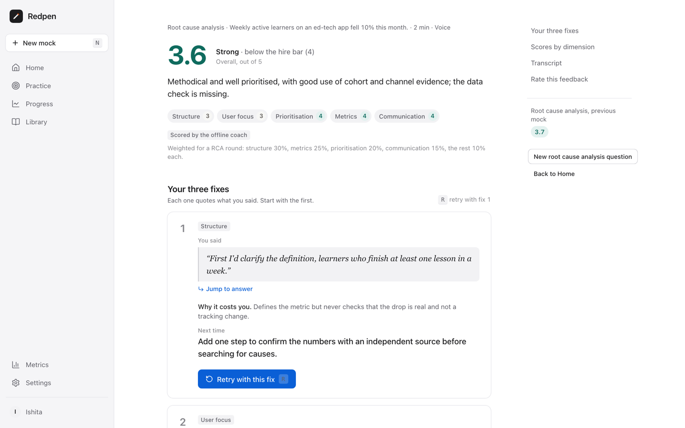
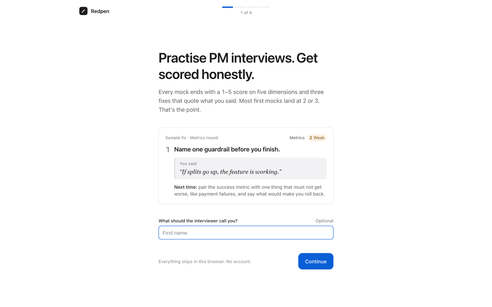
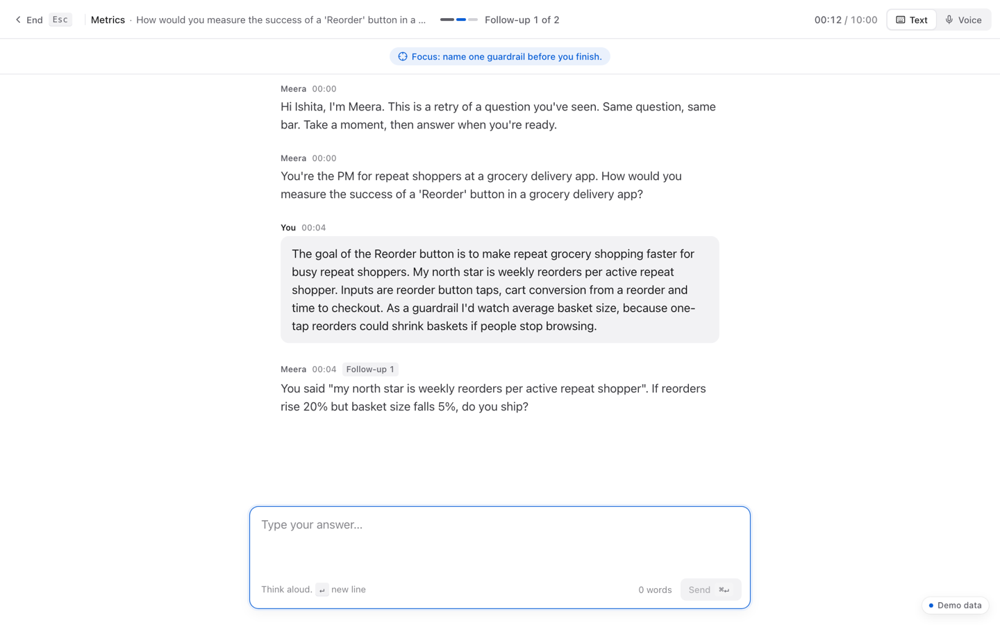
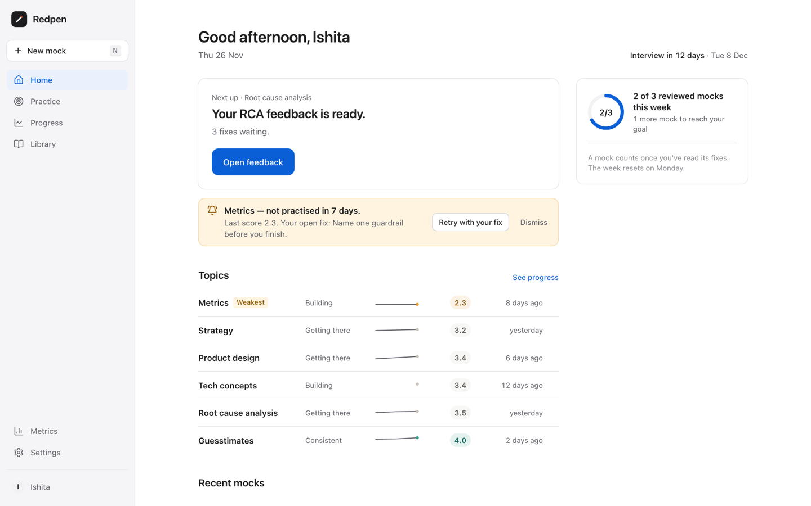
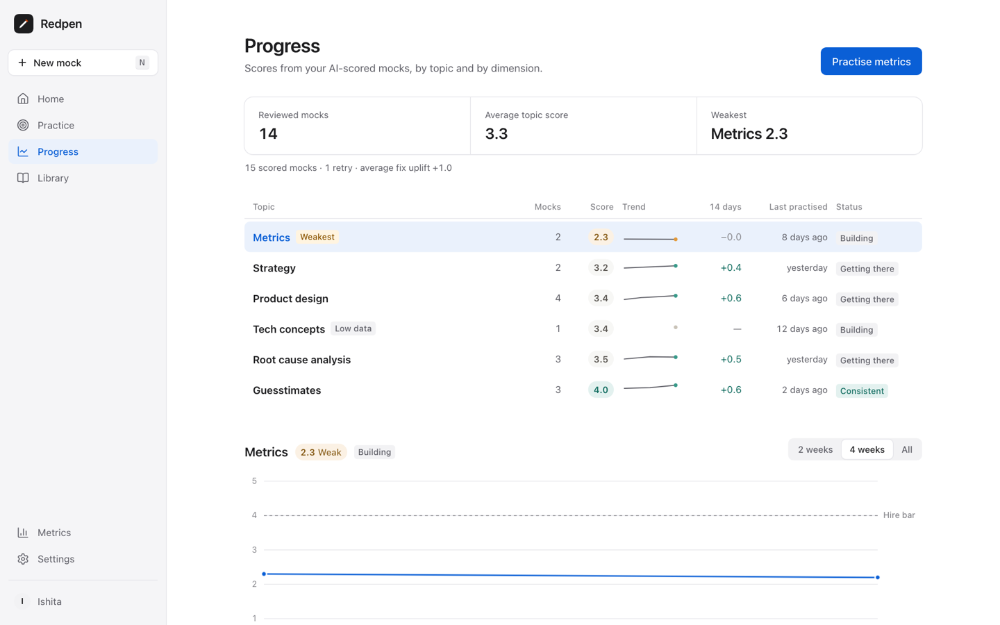
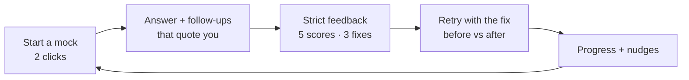
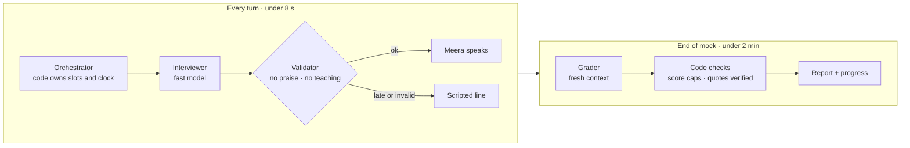

<div align="center">


# Redpen

**Honest feedback, on demand, that remembers.**

An AI mock interviewer for product management interviews. It marks your answer like a strict senior would, quotes your own words back to you, and keeps track of what you keep getting wrong.

[](https://github.com/Firoda/redpen-pm-interview/actions/workflows/ci.yml)
[](https://redpen-omega.vercel.app)


[**Try it live**](https://redpen-omega.vercel.app) · [How it works](#how-it-works) · [Run locally](#run-it-locally) · [Product docs](#product-docs)



</div>

---

## Why Redpen

We interviewed 24 ISB PGP students preparing for placements. Three problems kept coming up:

| | Problem | Raised by | In their words |
|---|---|---|---|
| 🎯 | Feedback they can trust | **18 of 24** | "AI tools are a bit submissive." |
| 📈 | Knowing what to fix next | **12 of 24** | "You give me 10 minutes of feedback, I note four or five lines." |
| 🕒 | Practising when they're free | **11 of 24** | Seniors are booked "15 days in advance". |

General AI flatters and forgets. Peers are polite. Seniors are busy. Redpen is built to fill that gap: **strict, on demand, and it remembers.**

## What it does

<table>
<tr>
<td width="50%" valign="top">

### 🎙️ Realistic mocks
Six PM topics (product design, RCA, metrics, guesstimates, strategy, tech concepts) and 96 curated questions. Answer by text or voice and switch mid-mock. Ask clarifying questions and get real answers back.

</td>
<td width="50%" valign="top">

### 🔍 Follow-ups that listen
The interviewer, Meera, quotes what you just said and pushes on it. Mid-way through, the case changes (a new user, market or constraint), the way it would in a real round.

</td>
</tr>
<tr>
<td valign="top">

### 🖍️ Strict, quoted feedback
Within 2 minutes: a 1–5 score with a reason on five dimensions (structure, user focus, prioritisation, metrics, communication), plus **3 fixes that each quote your own words**.

</td>
<td valign="top">

### 🔁 Retry with the fix
One tap re-asks the same question with your fix pinned. The new report shows whether the fix landed on that exact dimension.

</td>
</tr>
<tr>
<td valign="top">

### 📊 Progress that adds up
Score trends per topic, your weakest topic, and the mistakes that keep coming back.

</td>
<td valign="top">

### 🔔 Nudges that bring you back
Home names one next step: unread feedback, a fix to retry, or a topic you haven't practised in 7 days. Capped at 3 a day, and you can mute them.

</td>
</tr>
</table>

## Screenshots

| Onboarding | Mock interview |
|---|---|
|  |  |
| **Home** | **Progress** |
|  |  |

## How it works



**Strictness is enforced in code, not just requested in a prompt.**



- **Two separate calls.** A fast model runs the conversation. A separate grader scores the transcript in a fresh context, so the friendly chat can't soften the score.
- **Quotes are verified** against the transcript word for word. Scores can only be capped downwards.
- **It never stalls.** If the model is slow or fails, a scripted interviewer and an offline grader take over. The whole loop also works with no network at all.

## AI modes

| Mode | Interviewer | Grader | Needs |
|---|---|---|---|
| **Scripted** (default) | Rule-based follow-ups that quote your answer | Offline rubric coach | Nothing. Works offline |
| **Claude** | `claude-haiku-5-5` | Fast: Haiku · Thorough: `claude-sonnet-5-5` · Max: `claude-opus-5-5` | Your own API key, or a server key |

Turn Claude on in **Settings → Interviewer and grader**. A key you paste stays in your browser and is never exported. To use a server key instead, set `ANTHROPIC_API_KEY` on Vercel. The proxy in [`app/api/claude.ts`](app/api/claude.ts) only allows the Redpen models and caps request size.

## Run it locally

```bash
git clone https://github.com/Firoda/redpen-pm-interview.git
cd redpen-pm-interview/app
npm install
npm run dev          # http://localhost:5173
```

| Command | What it does |
|---|---|
| `npm test` | Runs the unit tests (Vitest) |
| `npm run build` | Typechecks and builds to `dist/` |
| `npm run preview` | Serves the production build |

> [!TIP]
> First-time visitors land on sample data: Ishita, three weeks into her prep. Click **Start my own practice** to clear it. Press `⌥D` (or add `?demo=1` to the URL) to open the demo panel.

Use Chrome on desktop for voice mode. Text mode works in any modern browser.

## Tech stack

| Layer | Choice |
|---|---|
| UI | React 19, TypeScript, Tailwind CSS v4, Radix primitives, Lucide icons |
| State | Zustand for the live mock; Dexie (IndexedDB) for everything stored |
| AI | Anthropic SDK, behind one `InterviewAI` interface with scripted, live and fallback providers |
| Voice | Web Speech API (speech recognition and synthesis) |
| Uploads | pdf.js and Mammoth, parsed in the browser |
| Tests | Vitest with fake-indexeddb |
| Hosting | Vercel (static site plus one serverless proxy) |

Everything runs in the browser. Profiles, mocks, scores, uploads and the event log stay on the device, and there is no account.

## Project structure

```text
.
├── app/                  # The Redpen web app
│   ├── api/claude.ts     # Vercel proxy for the server key
│   ├── src/
│   │   ├── app/          # Shell, router, theme
│   │   ├── engine/       # The only API the UI calls, plus view selectors
│   │   ├── domain/       # Pure logic: mock state machine, rubric, scoring, nudges, metrics
│   │   ├── ai/           # InterviewAI interface, scripted and Claude providers, prompts
│   │   ├── services/     # Database, clock, analytics, key store, voice
│   │   ├── features/     # Screens: onboarding, home, mock, feedback, progress, library…
│   │   ├── ui/           # Primitives, charts, the voice orb
│   │   └── content/      # 96 curated questions, seed data, demo fixtures
│   └── tests/            # Unit tests
├── docs/                 # Product plan, research and design system
└── .github/workflows/    # CI: test and build on every push
```

## Metrics

Every action is logged locally, and the in-app metrics panel computes the numbers from that log.

- ⭐ **North Star: Weekly Reviewed Mocks.** These are mocks finished with every follow-up answered and their feedback read as far as the fixes.
- **Pass bar for MVP 1:** at least 40% of new users do a second mock within 7 days.
- **Guardrails:** AI scores within ±1 of a senior's, feedback in under 2 minutes, and the nudge mute rate.

## Roadmap

- [x] **MVP 1. Trustworthy PM practice:** mocks, strict feedback, retry, progress, nudges
- [ ] **MVP 2. Prep for this role at this company:** accounts and sync, JD and company question sets, a 2–3 day plan, a senior calibration panel
- [ ] **MVP 3. Beyond PM, beyond campus:** consulting, GM and finance tracks; other B-schools; a premium tier

## Product docs

| Document | What's in it |
|---|---|
| [`docs/MASTER_PLAN.md`](docs/MASTER_PLAN.md) | The source of truth: decisions, screens, flows, AI design, data model, metrics, demo script |
| [`docs/research/`](docs/research) | UI design system, user journeys, features and architecture, competitor landscape |
| [`app/README.md`](app/README.md) | Developer notes: deploy steps, demo shortcuts, known limits |

## Team

Built for **Software Product Management** at the Indian School of Business, Hyderabad (Prof. Chandrashekhar V).

**Kartik Vashist · Geetanjan Roy · Aditya Firoda · Ananya Agarwal · Keerthana Gottipati**

<div align="center">
<sub>Scores are a practice signal, not a verdict. Confirm with a senior mock before the real interview.</sub>
</div>
