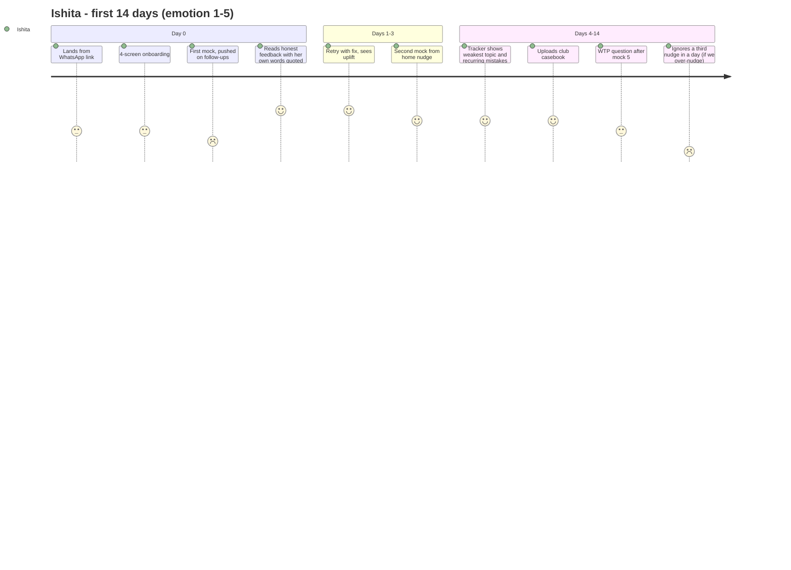
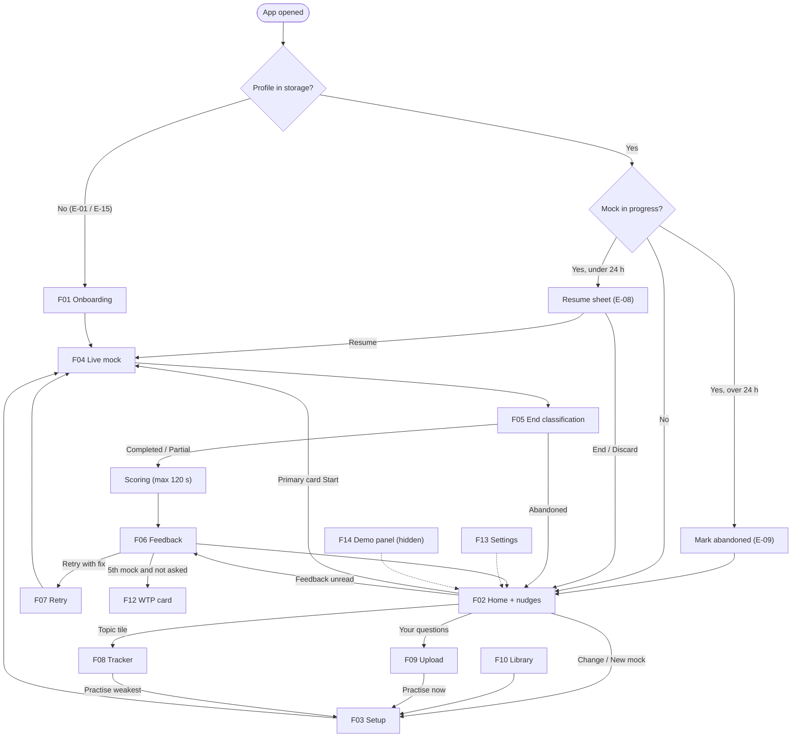
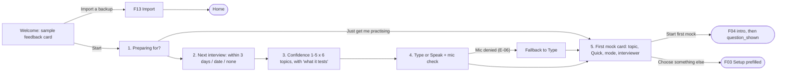
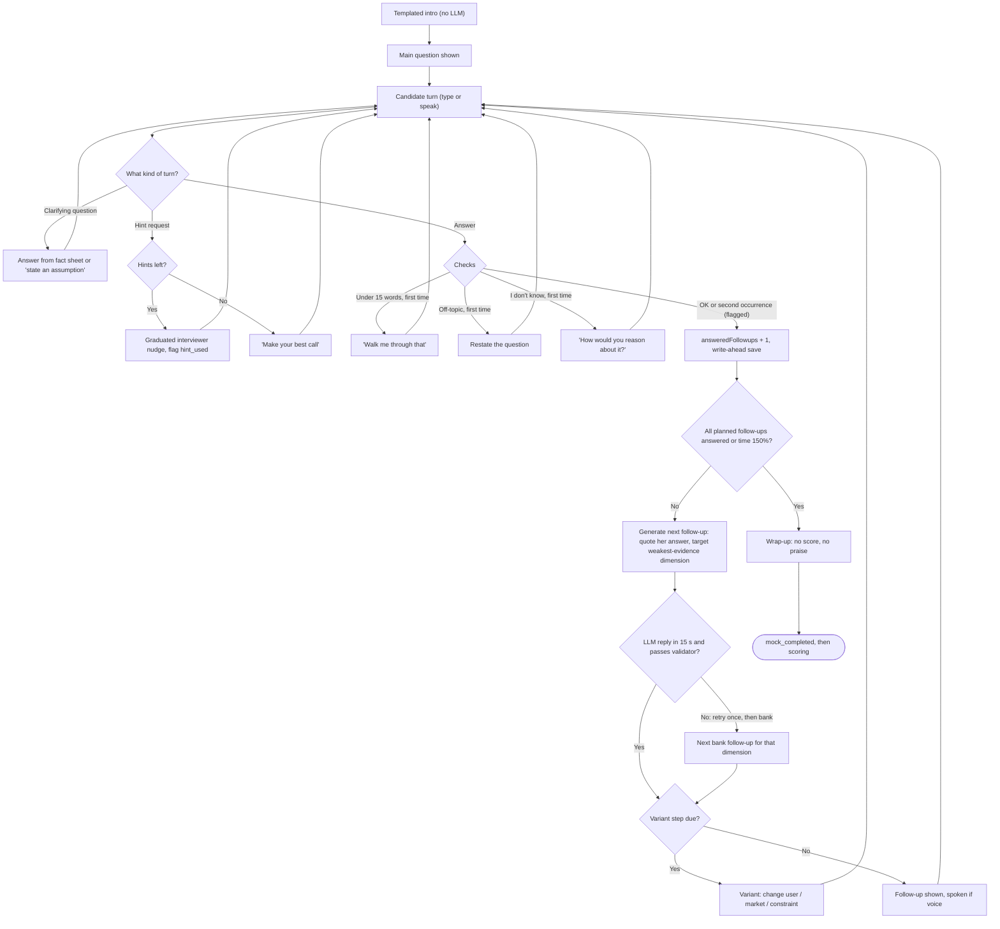
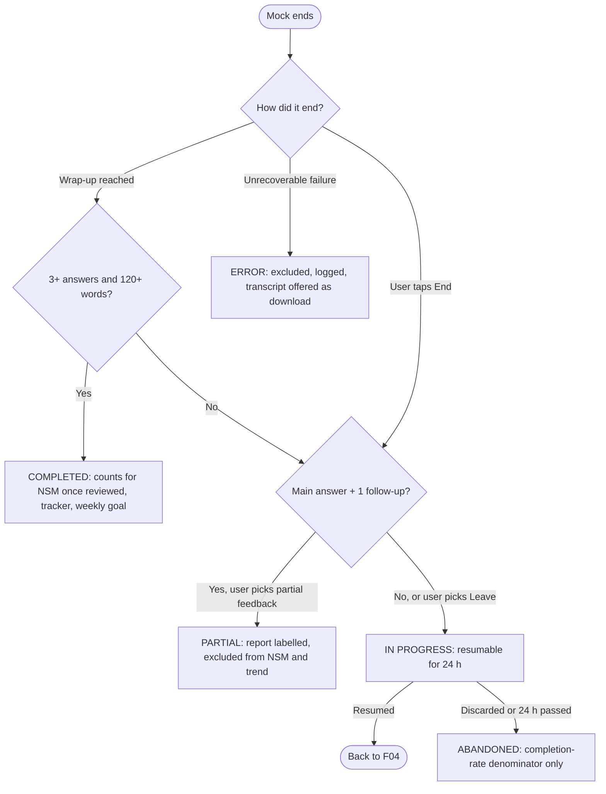
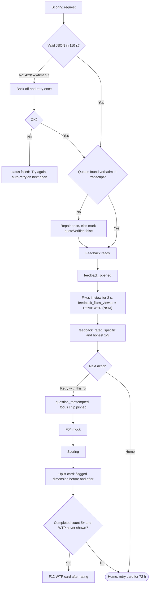
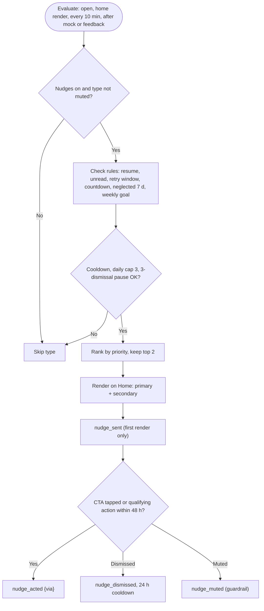
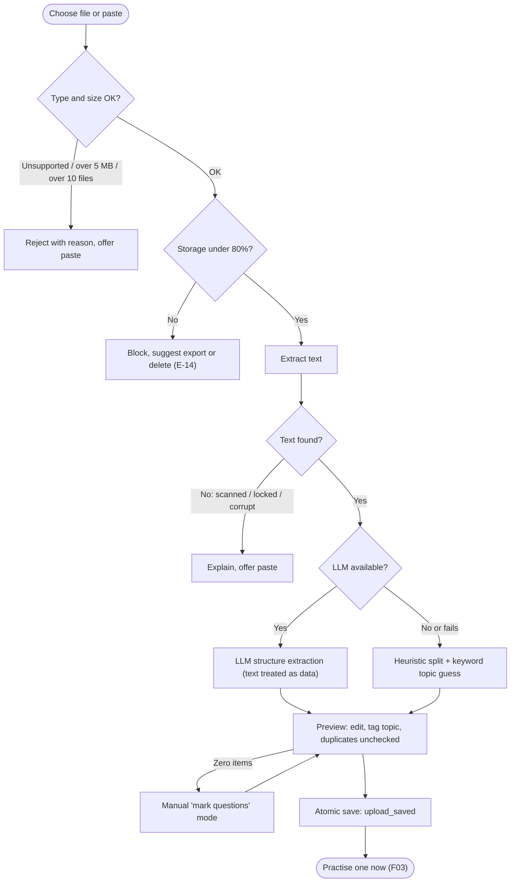
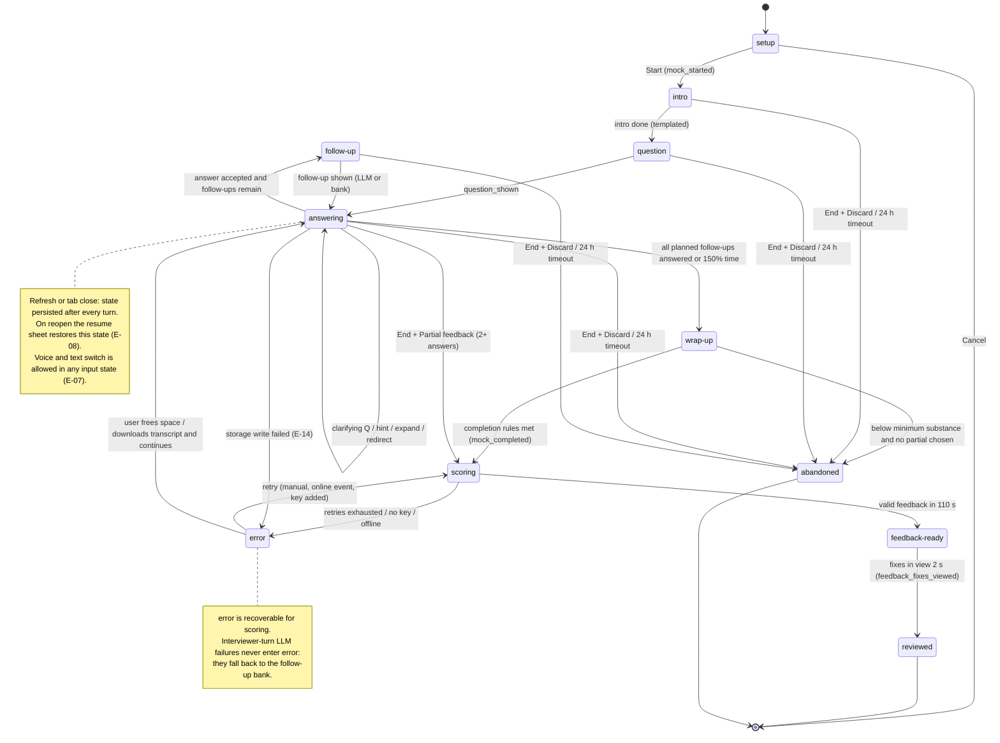

# 02 — User Flows, Journeys and Demo Script

**Product:** PM Mock Interview Companion (frontend-only, browser, local storage, LLM API wired later)
**Owner:** User-flow and journey lead
**Inputs:** `docs/00_CONTEXT_BRIEF.md`, `docs/source-text/assignment1_personas_hypotheses.txt` (5 interviews, individual), `docs/source-text/game_framework_nsm_strategy_roadmap.txt` (24-candidate team research, GAME, NSM, MVP), `docs/source-text/final_demo_template.txt` (grading template)
**Status:** Planning artefact. No application code. Every flow below is written so a build prompt can be generated from it directly.

---

## 0. How to read this document

### 0.1 Decisions this document makes (one-line versions)

| # | Decision | Why (evidence) |
|---|---|---|
| D1 | **Activation = first "reviewed mock"**: mock completed (all planned follow-ups answered) AND feedback scrolled to the 3 fixes. Not sign-up, not "mock started". | NSM slide: "A mock finished and its feedback read. That one event delivers all three goals." |
| D2 | **Onboarding is 4 short screens, ≤ 60 s, no account, no API key, and ends inside the first mock.** No separate calibration test: the first mock *is* the calibration, and the report shows "you rated yourself X, you scored Y". | Time-to-first-question is a Goal-2 metric; Pritish "I never knew that I am ready"; Hypothesis 2 test is "self-rated readiness vs expert rating". |
| D3 | **Interviewer persona changes tone, never the scoring.** Scoring is always strict-by-default and uses the same rubric. | P1 (18/24) "AI tools are a bit submissive"; guardrail "too lenient repeats the ChatGPT problem; too harsh and users quit". |
| D4 | **No coaching during the mock.** Hints exist but behave like a real interviewer's nudge (max 2, logged, cost points). Teaching happens only in the feedback. | Non-goal "live in-mock coaching"; realism (8/24). |
| D5 | **Fixes never write the answer for the user.** Each fix = her exact words → why it costs her → what to do next time. | Non-goal "writing answers for the user"; MVP item 4 "3 fixes quoting the user's words". |
| D6 | **The mock never dies because the LLM did.** Every library question ships with an authored follow-up bank and a variant, so interviewer turns degrade to scripted ones; scoring is queued, never faked. | Brief: "must degrade gracefully / have a scripted fallback"; guardrail "feedback within 2 min". |
| D7 | **Hooks are all in-app (no server):** home nudges, retry window, weekly goal, interview countdown, optional calendar (.ics) reminder, browser notification only if the tab is open. WhatsApp nudges stay Wizard-of-Oz in the real test. | Frontend-only constraint; MVP test plan "Nudges sent by the team on WhatsApp (Wizard of Oz)". |
| D8 | **A hidden Demo Mode** loads seed personas, shifts the app clock, switches LLM between Live / Scripted / Live-with-fallback, ghost-types prepared answers and shows a live event log so graders can see telemetry fire. | Demo template: "Don't make it completely stubbed, some features need to work end-to-end"; feature table must show telemetry. |

### 0.2 Conventions

- **Topics (6):** `product_design`, `rca`, `metrics`, `guesstimate`, `strategy`, `tech`.
- **Dimensions (5):** `structure`, `user_focus`, `prioritisation`, `metrics`, `communication`.
- **Flow IDs** `F01…F15`; **edge-case IDs** `E-xx` (global catalogue in §3.0, referenced by every flow so behaviour is defined once).
- **Events:** `snake_case`. The 8 events named in the GAME deck are marked **(canonical)** and keep exactly those names. Every event carries the envelope in §3.0.3.
- **Storage:** small, synchronous state in `localStorage` under the `pmc.` prefix; transcripts, feedback, questions, uploads and the event log in IndexedDB database `pmc` (localStorage is capped near 5 MiB per origin by the WHATWG spec and throws `QuotaExceededError` when full).
- **"Today"** always means the app clock (`now() + demo.clockOffsetDays`), so seeded data and nudges can be time-shifted for the recording.

---

## 1. Pain point → evidence → product response traceability

Frequencies: team research is "n of 24 candidates" (from the GAME deck); individual research is "n of 5 working professionals" (from Assignment 1 affinity map). Where the source quotes a person but records no count, the column says *quote only*. Nothing here is invented: every quote below appears in `docs/source-text/`.

### 1.1 Team research (24 ISB candidates) — MVP drivers

| ID | Pain | Evidence (verbatim) | Freq. | Persona | Flow(s) that answer it | Product response | Metric / event that proves it |
|---|---|---|---|---|---|---|---|
| T1 | General AI and peers flatter; no honest, role-aware feedback (**P1**) | "AI tools are a bit submissive"; general AI "is generally like, yeah, you're doing good" | **18/24** | Ishita (primary), Vikram | F04, F06 | Strict 5-dimension rubric, 1–5 with a reason each, 3 fixes quoting her words; interviewer never praises mid-mock; scoring identical across interviewer styles (D3) | `feedback_rated` (canonical) → **feedback trust score** = % rated 4–5 on "specific & honest"; guardrail: AI within ±1 of senior mock on a sample |
| T2 | Interviewers never say why a round went wrong; candidates lose rounds on answers that "felt fine" | Deck: "interviewers never say why a round went wrong. Candidates lose rounds on answers that felt fine" | *summary of 18/24* | Ishita | F06, F08 | Every score has a reason tied to an evidence quote; tracker shows recurring mistakes across mocks | `feedback_fixes_viewed` (NSM component); **feedback read rate** |
| T3 | Needing to engineer strict prompts to get honest AI feedback | "I don't know what the right prompt is" | *quote only* | Ishita | F01, F03, F04 | Zero prompt setup: pick topic → start; rubric built in | **time to first question** (`question_shown.ms_since_app_open`); onboarding completion |
| T4 | Practice stalls when no one is free; seniors are booked out (**P4**) | Seniors booked "15 days in advance" for a 20-minute slot | **11/24** | Ishita, Vikram | F02, F03, F04 | Start a mock in ≤ 2 taps from home, any hour, no booking | `mock_started` (canonical); **mocks per active user** (target 3+/wk); **second-mock rate** ≥ 40% in 7 days (MVP pass) |
| T5 | AI voice feels artificial and laggy | Paid case bot has "about a minute's lag" | *quote only; realism raised by* **8/24** | Ishita | F04 (voice) | Browser TTS/STT, push-to-talk, live transcript; interviewer reply target < 5 s | `turn_latency_ms` on `followup_asked`; guardrail p50 < 5 s; completion split voice vs text |
| T6 | Feedback is scattered across people and tools and nothing adds it up (**P3**) | "you give me 10 minutes of feedback, I note four or five lines" | **12/24** | Ishita, Rohan | F06, F08 | Every mock writes scores to a per-topic history automatically; recurring mistakes are clustered | `tracker_viewed` (canonical) → **tracker engagement**; **improvement** (weakest topic +1 in 14 days) |
| T7 | Manual error logs; intention to reflect not matched by behaviour | Candidates "keep manual error logs"; "I should reflect more often"; "Only one candidate showed this in behaviour" | *within 12/24; 1/24 shown in behaviour* | Ishita | F02, F08, F11 | Reflection is pushed to them: unread-feedback nudge, "recurring mistakes" panel, retry card on home | `nudge_acted` (canonical) on unread-feedback nudges; tracker vs non-tracker retention cohort (riskiest-goal test) |
| T8 | General AI forgets: context lost by the 2nd–3rd case | "ChatGPT loses context by the 2nd–3rd case" | *quote only* | Ishita | F06, F07, F08 | Persistent history; retry compares against the original attempt; weakest topic carried across sessions | `question_reattempted` (canonical) → **fix-applied rate** (re-attempt within 72 h) |
| T9 | Feedback that is read but not acted on (opening ≠ trusting) | Deck: "Read rate alone is a vanity check: opening is not trusting" | *team analysis* | Ishita | F07 | One-tap retry with the chosen fix pinned; uplift card on the flagged dimension | **fix uplift** = Δ score on flagged dimension; `retry_completed`, `uplift_shown` |
| T10 | Scattered material; wants one trusted PM library | "One trusted PM library … instead of scattered material"; "for product there are four or five types of questions" | *quote only; 5/24 target PM* | Ishita, Sneha | F10, F03 | 6 topics × 15+ curated questions, each with follow-up bank and case variants | `library_viewed`, `question_previewed`; mocks per active user |
| T11 | Their own casebooks/question lists sit unused in PDFs | MVP item 2 "questions or casebooks, visible only to the user" | *MVP scope* | Ishita | F09, F03 | Upload .txt/.md/.pdf/.docx/.csv or paste; parse → preview → tag → practise; stays in browser | `upload_parsed`, `mock_started{source:"upload"}`; share of mocks from uploads |
| T12 | Same question gets stale; need case variants | MVP item 3 "case variants that change the user, market or constraint" | *MVP scope* | Ishita | F03, F04, F07 | Variant step inside Standard/Full mocks; "practise a variant" on retry | `variant_presented`; `mock_started{source:"variant"}` |
| T13 | Time budget: 1–2 h/day around classes; one mock must fit a free slot | "Several mocks a week, 1–2 hours a day around classes: one 20–30 minute mock fits a free slot" | *team analysis* | Ishita | F03 | Quick 10 / Standard 20 / Full 30 min lengths; resume within 24 h | completion rate by length; `mock_abandoned.reason` |
| T14 | Paying for a patchwork of tools | ChatGPT Go ~₹400/mo, Claude ~₹25,000/yr, ₹50,000 coaching package | *spend seen* | Ishita | F12 | WTP prompt after mock 5 framed on what she would lose (history) | `wtp_answered` → **willingness to pay** % yes |
| T15 | JD/company-specific prep for an interview 2–3 days out (**P2**) | Rohan: "interview 2–3 days out, multiple tracks, needs JD/company tailoring" | *Phase 2 persona* | Rohan | F01 (date ≤ 3 days), F02 (countdown), F10 (fake door) | MVP: short-notice mode re-orders home to weakest topics + Quick mocks; JD tailoring shown as "coming soon — tell us your JD" fake door | `jd_interest_clicked` (fake-door demand for Phase 2); reviewed mocks in the 3 days before an interview date |
| T16 | Nagging hurts retention | Deck guardrail: "nudge mute or opt-out rate; nagging hurts retention" | *guardrail* | All | F11, F13 | Max 1 primary + 1 secondary nudge, 24 h cooldown per type, mute per type | `nudge_muted` rate (guardrail) vs `nudge_acted` (canonical) |
| T17 | Harsh-but-wrong scores would drive users away | "too harsh and users quit" | *guardrail* | All | F06 | Every score cites evidence; rating + free-text "what's wrong with this feedback"; calibration sample export | `feedback_rated` ≤ 2 rate; `feedback_disputed` |
| T18 | Peer mocks remain valuable (not replacing humans) | "Not a goal: replacing human mocks; peer mocks should continue" | *positioning* | All | F06 (export for a senior), F13 | "Share transcript + scores with a senior" (copy/export) — also feeds the calibration guardrail | `transcript_exported`; calibration sample size |

### 1.2 Individual research (5 working professionals) — secondary personas, positioning and later phases

| ID | Pain | Evidence (verbatim) | Freq. | Persona (individual → team) | Flow(s) | Product response (MVP or deferred) | Metric / event |
|---|---|---|---|---|---|---|---|
| I1 | Unknown unknowns: whole question types never appear in prep | Dhanush: "it was something that completely missed my radar during my preparation" | **3/5** (Theme 1) | Sneha → Vikram | F01, F10 | Onboarding self-rating screen doubles as a map of the 6 PM question types with a one-line "what it tests"; library shows untried types; tracker shows "never practised" topics | `onboarding_step_completed{step:"confidence"}`; % of users who practise ≥ 4 of 6 topics in 14 days |
| I2 | Hiring process is a black box | Vinay: "To be honest, it is To some extent, it is black box. You are not aware of what a what all a company can ask for." | 3/5 (Theme 1) | Karan → Rohan/Vikram | F10 (fake door), roadmap | Deferred: role decoder / JD tailoring (Phase 2). MVP: topic map + interview-structure note on each topic page | `jd_interest_clicked` |
| I3 | Candidates don't research the specific role | Jinendra: "they are maybe just trying randomly and they are not serious about getting the job" | 3/5 (Theme 1) | Karan | Roadmap | Deferred (P2). MVP captures target role and company free-text for later tailoring | `profile.targetCompany` fill rate |
| I4 | No practice / case partners while working | Pritish: "I did not have any case partners … I was completely relying on ChatGPT at that time." | **3/5** (Theme 2) | Sneha → Vikram | F03, F04 | On-demand mock with a realistic interviewer | `mock_started`, second-mock rate |
| I5 | Feedback comes from non-experts | Dhanush: "I used to run it by some other people, but these are non-product folks." | 3/5 (Theme 2) | Sneha | F06 | PM-specific rubric; reasons per dimension; calibration against senior mocks | feedback trust score |
| I6 | Human judgement matters; AI only for early practice | Pritish: "for the initial level of practising … I would really recommend to practice with an AI … going near to the D day … practice with humans" | quote | Sneha | F02, F06 | Positioning: AI for volume, humans near D-day. Countdown banner at ≤ 3 days suggests "book a human mock too" and offers transcript export to share | `transcript_exported` |
| I7 | No readiness signal | Pritish: "So I never knew that I am ready for it" | **2/5** (Theme 5) | Sneha → Vikram | F06, F08 | Self-rated vs scored gap on first report; per-topic status "Not started / Building / Consistent (3 mocks ≥ 4.0)" — deliberately not called "ready" (see §6 risk R7) | % users with ≥ 1 "Consistent" topic by interview date |
| I8 | Started prep, dropped it as overwhelming | Manraj (interviewer note): "dropped it midway because the interview preparation felt overwhelming" | **3/5** (Theme 4) | Rahul → Vikram | F02 | Home shows **one** next best action, not a syllabus; Quick 10-min mock; weekly goal of 3 (not daily streak) | D7/D14 retention; `nudge_acted` |
| I9 | Material scattered; prep is "Chaos" | Vinay: "Chaos."; Manraj: LeetCode, paid courses, YouTube | 3/5 (Theme 4) | Rahul, Karan | F10, F09 | One library + own uploads in one place | share of mocks from uploads; library → mock conversion |
| I10 | Prep only fits evenings / two evenings before | Jinendra: imagine "2 days before the actual interview" | quote | Rahul, Rohan | F01, F02 | Interview-date capture; ≤ 3 days → short-notice plan (weakest 2 topics, Quick mocks) | reviewed mocks in final 3 days |
| I11 | Structuring answers took weeks | Pritish: "took me around 4 to 5 weeks to prepare or to sharpen them" | quote | Sneha | F06, F08 | `structure` is dimension #1; recurring-mistake tags make the structure gap visible early | structure score trend |
| I12 | Senior rounds test nuance, not just correct answers | Manraj: "knowing an answer is not enough" | quote | Rahul | F04 | Adaptive follow-ups that probe *why*, trade-offs and edge cases of her own answer | follow-ups per mock; `followup_asked.source:"llm"` share |
| I13 | Strategy answers fail the feasibility reality check | Vinay: candidates propose strategies that "can be implemented, but actually cannot be implemented in reality" | quote | All | F04 (strategy follow-up pattern) | Strategy follow-up bank always includes a feasibility/execution probe | `prioritisation` score on strategy |
| I14 | Interview dates not under their control | Pritish: "the dates were not under my control" | 2/5 (Theme 5) | Sneha, Rohan | F01, F13 | Interview date editable any time; "No date yet" is a first-class option | `profile_date_updated` |
| I15 | No story bank; restarts from scratch | Vinay: "Not really, although that is a good idea." | 3/5 (Theme 5/6) | Karan | Roadmap | Deferred (behavioural/story bank is out of the 6 PM topics). History is retained across seasons (export/import) | — |
| I16 | Positioning a broad profile | Vinay: profile "suitable only to certain kind of roles"; Jinendra: "know what you did and position yourself" | 3/5 (Theme 6) | Karan | Roadmap | Deferred (resume/application tools are a "never" non-goal) | — |
| I17 | Would pay when short of time or network | Jinendra: "I'll definitely go for it because the marginal utility is definitely there" | quote | Rahul | F12 | WTP prompt; premium = history + unlimited voice | `wtp_answered` |
| I18 | Wants a structured way through prep | Dhanush: "it has a very structured way of going through interview preparation" (on Exponent) | quote | Sneha | F02, F10 | Topic map, one next action, per-topic progress | tracker engagement |

### 1.3 Coverage check

- Every MVP1 item (1–8) maps to at least one pain above: (1) T4,T5,T10 · (2) T11 · (3) T12,I12,I13 · (4) T1,T2,T17 · (5) T6,I7 · (6) T7,T16,I8 · (7) all metrics · (8) T8,T9.
- Pains deliberately **not** solved in MVP (I2, I3, I15, I16, T15-tailoring) each have a fake door or roadmap hook so the demo can say *why* they were cut.

---

## 2. Persona journeys

### 2.1 Ishita — the mock-heavy PM aspirant (MVP primary)

**Who:** ISB PGP, placement season, targeting APM/PM roles. Does several mocks a week; 1–2 h/day around classes; uses ChatGPT with a "strict" prompt plus peer mocks plus a senior when she can get one. Has a PDF casebook from the PM club. Wants honest, specific feedback and to know what to fix next.

#### 2.1.1 A day in the life (placement season, Tuesday)

| Time | What happens | Trigger | Touchpoint | Feeling |
|---|---|---|---|---|
| 08:30 | Checks WhatsApp PM-prep group: a classmate shares a shortlist and "anyone free for a mock tonight?" — nobody is | Social pressure, shortlist | WhatsApp | Anxious |
| 10:00–13:00 | Classes | — | — | — |
| 13:15 | 40-min gap after lunch. Opens laptop. Home shows "Metrics: untouched 8 days · Quick 10-min mock" | Free slot + nudge | **Home (F02)** | Mildly guilty, motivated |
| 13:17 | Takes a Quick metrics mock in text (library is in a quiet place) | Primary CTA | **Mock (F04)** | Focused, slightly stressed when pushed on counter-metrics |
| 13:29 | Feedback in < 2 min: metrics 2/5 "no counter-metric"; fix quotes "we'll track engagement" | Wrap-up | **Feedback (F06)** | Stung but "finally someone says it" |
| 13:31 | Rates feedback 5 "specific & honest", taps "Retry with this fix" — no time, saves for evening | Retry card | F06 → F07 | Determined |
| 19:30 | Peer mock cancelled. Home shows retry card "Apply your fix — 66 h left" | Retry window | **Home (F02)** | Relieved there's an alternative |
| 19:32 | Retry in **voice** (room is private); switches to text for a calculation | Retry | **Mock (F04)** | Flow |
| 19:45 | Uplift card: Metrics 2 → 4 on the flagged dimension | Retry done | **Uplift (F07)** | Proud — the "I'm getting better" moment |
| 19:47 | Opens tracker: weakest topic is now Guesstimate; "Jumps to solutions" recurring ×4 | Curiosity | **Tracker (F08)** | In control |
| 23:00 | Uploads the PM club casebook so tomorrow's mock uses a familiar case | Planning tomorrow | **Upload (F09)** | Ownership |

#### 2.1.2 Journey map — first 14 days

| Stage | Day | Trigger | Actions | Touchpoints / screens | Thinking (her words or research words) | Emotion (−2…+2) | Drop-off risk | Design response | Event(s) |
|---|---|---|---|---|---|---|---|---|---|
| Discover | 0 | Link in section / PM-club WhatsApp group (GTM) | Clicks link, lands on app | Welcome | "Another AI tool that says I'm doing good?" | 0 | Bounces if it looks like generic chat | Welcome line: "Honest feedback, on demand, that remembers." Show a sample feedback card, not a chat box | `app_opened{first:true}` |
| Onboard | 0 | Curiosity | Goal, date, self-ratings, mode | F01 (4 screens) | "Don't make me fill a form" | +0.5 | Quits on long forms or a sign-up wall | No account; 4 screens ≤ 60 s; every field skippable; progress dots | `onboarding_started`, `onboarding_step_completed`, `onboarding_completed` |
| First mock | 0 | Recommended Quick mock on lowest-rated topic | Answers question + 2 follow-ups | F04 | "Is this as real as a senior?" | −0.5 (pressure) | Abandons if interviewer is slow, robotic, or asks an irrelevant follow-up | Follow-up quotes her answer; < 5 s replies; visible "2 of 3" progress | `mock_started`, `question_shown`, `followup_asked` |
| **Activation** | 0 | Wrap-up | Reads 5 scores, 3 fixes, self-vs-scored gap; rates | F06 | "AI tools are a bit submissive" → this one isn't | +1.5 (or −1 if unfair) | Distrust if a score has no evidence; hurt if harsh without reason | Every score has a reason + quote; "Was this specific & honest?" 1–5 | `mock_completed`, `feedback_opened`, `feedback_fixes_viewed`, `feedback_rated` |
| Apply | 0–3 | Retry card (72 h window) | One-tap retry with fix | F07 | "Did I actually fix it?" | +1.5 | Forgets; window passes | Retry card on home with hours left; nudge at 24 h and 60 h | `question_reattempted`, `retry_completed`, `uplift_shown` |
| Second mock | 1–7 | Free slot + home next-best-mock | New topic mock | F02 → F03 → F04 | "One more before the weekend" | +1 | Life happens; peer mocks take priority | Weekly goal ring "1 of 3 this week"; neglected-topic nudge | **second-mock rate** (`mock_completed` #2 within 7 d) |
| Habit | 3–14 | Nudges, countdown | 3+ mocks/week; tracker check | F08, F11 | "Show me which mistakes keep coming back" | +1 | Nudge fatigue; plateau in scores | Max 2 nudges; mute per type; recurring mistakes reframe plateau as "the one thing to fix" | `tracker_viewed`, `nudge_sent`, `nudge_acted` |
| Own content | 4–10 | Casebook sitting unused | Upload PDF, practise own case | F09 | "Let me practise the club casebook" | +0.5 | Parse fails on scanned PDF | Paste fallback; preview/edit before save | `upload_started`, `upload_parsed`/`upload_failed` |
| Monetise | ~day 7–10 (mock 5) | 5th completed mock | Answers WTP | F12 | "Would I pay to keep this history?" | 0 | Feels like a paywall | Ask after rating, framed as a question; no payment, no lock | `wtp_prompt_shown`, `wtp_answered` |

### 2.2 Rohan — the short-notice multi-tracker (Phase 2, partially served in MVP)

**Who:** ISB PGP with an interview 2–3 days out, applying to PM *and* other tracks. Needs JD/company tailoring (P2, Phase 2). In MVP he gets a short-notice plan built only from generic PM topics.

| Stage | Trigger | Actions | Touchpoint | Thinking | Emotion | Drop-off risk | MVP response | Event(s) |
|---|---|---|---|---|---|---|---|---|
| Panic | Shortlist email: interview in 2 days | Opens app late at night | Welcome | "I have two evenings" | −1.5 | Leaves if setup takes more than a minute | Onboarding step 2 "Interview in ≤ 3 days" chip; skip self-ratings with "Just get me practising" | `onboarding_skipped{at_step}` |
| Plan | Short-notice mode | Sees "2-day plan: 4 Quick mocks on your 2 lowest topics" | Home (short-notice variant) | "Just tell me what to do" (Rahul overwhelm) | 0 | Plan feels generic vs the JD | Fake door: "Paste the JD (coming soon)" captures demand | `jd_interest_clicked`, `plan_viewed` |
| Cram | Evening 1 & 2 | 2 Quick mocks per evening | F04, F06 | "Which mistake costs me most?" | +0.5 | Feedback latency > 2 min kills cram flow | 2-min guardrail; feedback-ready badge if he navigates away | `mock_completed`, `feedback_opened` |
| D-day | Morning | Reads top 3 recurring mistakes | Tracker "Before your interview" card | "What to remember walking in" | +1 | — | Countdown card on D-day: 3 recurring mistakes, no new mock pushed | `tracker_viewed{context:"d_day"}` |
| After | Interview done | Marks outcome (optional) | Home prompt "How did it go?" | — | ± | Churns after interview | Ask for next interview date to restart loop | `interview_outcome_logged` |

### 2.3 Vikram / Sneha — working professional switching into PM (Later persona; individual research)

**Who:** 3–5 years in ops/analytics/engineering, moving to PM while employed. Evenings only. Doesn't know what PM interviews test (Dhanush), has no expert feedback (Pritish), and may have dropped prep before because it felt overwhelming (Manraj).

| Stage | Trigger | Actions | Touchpoint | Thinking (research quotes) | Emotion | Drop-off risk | MVP response | Event(s) |
|---|---|---|---|---|---|---|---|---|
| Orientation | Decides to switch | Opens app on a weeknight | F01 confidence screen | "It was something that completely missed my radar" | −0.5 | Doesn't recognise topic names ("RCA?") | Each topic shows a one-line "what this tests" and an example question | `onboarding_step_completed{step:"confidence"}`, `topic_info_opened` |
| First try | Recommended Warm-up difficulty | Quick product-design mock, Friendly-senior interviewer | F03, F04 | "Not very confident" | −1 | Freezes; says "I don't know" | IDK handling: interviewer asks her to reason aloud, offers to reframe; hint button | `idk_detected`, `hint_requested` |
| Feedback | Report | Low scores with reasons | F06 | "These are non-product folks" (her usual feedback) — now PM-specific | +0.5 (or −1.5 if harsh with no path) | Demoralised by 1s and 2s | Report leads with "one thing to fix first", then the scores; self-vs-scored gap framed as a starting baseline | `feedback_rated` |
| Rhythm | Weekly goal | 3 mocks/week, evenings | F02 | "Chaos" → one next action | +1 | Work crunch week breaks streak | Weekly (not daily) goal; neglected-topic nudge after 7 days only | `nudge_acted` |
| Readiness | 4–5 weeks (Pritish's structuring timeline) | Tracker shows "Consistent" on 3 topics | F08 | "I never knew that I am ready" | +1.5 | Over-trusts the AI's readiness signal | Status wording avoids "ready"; suggests a human mock near D-day (I6) | `topic_status_changed` |

### 2.4 Cross-persona drop-off risks and where the product intercepts them

| Drop-off point | Who | Signal we can see | Intercept |
|---|---|---|---|
| Welcome → onboarding step 1 | All | `app_opened` without `onboarding_started` | Sample feedback card on welcome; single "Start" CTA |
| Mid-onboarding | Rohan | `onboarding_step_completed` stops | Every step skippable; "Just get me practising" |
| Setup → start | Ishita | `mock_setup_viewed` without `mock_started` | Pre-filled recommendation; 1 tap to start |
| Mid-mock | All | `mock_abandoned{reason}` | Resume within 24 h; partial feedback after ≥ 2 answers |
| Scoring wait | All | `feedback_generated.latency_ms` > 120 000 or user leaves | Progress copy; feedback-ready badge + nudge |
| Feedback opened, fixes not reached | All | `feedback_opened` without `feedback_fixes_viewed` | Fixes are above the fold on desktop; "3 fixes ↓" anchor |
| No second mock in 7 days | All | cohort metric | Retry card, neglected-topic nudge, weekly goal |
| Nudge fatigue | All | `nudge_muted`, `nudge_dismissed` streak | Cooldowns; ≤ 2 nudges; auto-pause after 3 consecutive dismissals |

---

## 3. User flows

### 3.0 Shared foundations (referenced by every flow)

#### 3.0.1 Flow inventory

| ID | Flow | MVP item | Priority | In demo? | Live vs seeded in demo |
|---|---|---|---|---|---|
| F01 | First-run onboarding | — (activation path) | Must | Yes (beat 2) | Live |
| F02 | Home dashboard + in-app nudges | 6 | Must | Yes (beats 2, 6) | Live UI over seeded history |
| F03 | Start a mock (setup) | 1, 2, 3 | Must | Yes (beat 3) | Live |
| F04 | Live mock conversation | 1, 3 | Must | Yes (beat 3) | Live LLM with scripted fallback; ghost-typed answers |
| F05 | Ending a mock (complete / abandoned / resume) | 3, 7 | Must | Implicit | Live |
| F06 | Feedback report + rating | 4, 7 | Must | Yes (beat 4) | Live LLM scoring (scripted fallback) |
| F07 | One-tap retry with fix + uplift | 8 | Should | Yes (beat 7) | Live; baseline attempt seeded |
| F08 | Progress tracker | 5 | Must | Yes (beat 6) | Seeded history + 1–2 live points |
| F09 | Upload own questions / casebook | 2 | Must | Yes (beat 8, short) | Live parse of a prepared file |
| F10 | Question library browsing | 1 | Must | Brief | Live (seeded library content) |
| F11 | Nudge engine (generation, delivery, attribution) | 6 | Must | Yes (beat 6) | Live rules over seeded clock |
| F12 | Willingness-to-pay prompt (after mock 5) | GAME goal 3 | Should | Yes (beat 8) | Live trigger on seeded count |
| F13 | Settings, API key, data export/import/reset | — | Must | No | — |
| F14 | Demo mode / seed reset (hidden) | — | Must for recording | Off-camera | — |
| F15 | Metrics panel (local NSM + funnel from events) | 7 | Should | Yes (beat 9) | Computed live from seeded + live events |

#### 3.0.2 Data written to local storage (logical model)

`localStorage` (small, sync; key prefix `pmc.`):

| Key | Shape (abridged) | Written by |
|---|---|---|
| `pmc.schemaVersion` | `1` | boot / migrations |
| `pmc.profile` | `{ localUserId, name?, goal: "pm_placement"|"pm_switch"|"other", targetRole?, targetCompany?, interviewDate: ISO|null, dateStatus: "set"|"none"|"within_3_days", selfRatings: {topic: 1-5|null}, preferredMode: "text"|"voice", createdAt, onboardingCompletedAt?, onboardingSkippedAt? }` | F01, F13 |
| `pmc.settings` | `{ interviewerStyle: "senior"|"hiring_manager"|"bar_raiser", defaultLength, voice: {sttLang:"en-IN", ttsVoice, rate, autoSpeak}, weeklyGoal: 3, nudges: {enabled, muted:{type:bool}, browserNotifications:bool}, llm: {provider, model, timeoutsMs} }` | F01, F03, F13 |
| `pmc.apiKey` | string (never exported, never logged) | F13, F14 |
| `pmc.activeMock` | `{ mockId, tabId, heartbeatAt, state }` | F04 (every turn + heartbeat 5 s) |
| `pmc.nudges` | `[{ id, type, topic?, mockId?, createdAt, firstShownAt?, dismissedAt?, actedAt?, actedMockId?, expiresAt }]` + `lastEvaluatedAt` | F11 |
| `pmc.flags` | `{ firstMockDone, firstReviewedAt, wtp: {shownAt?, answer?, price?, reaskAfterMock?}, persistRequested, tooltipsSeen[] }` | F01, F06, F12 |
| `pmc.demo` | `{ enabled, clockOffsetDays, llmMode: "live"|"scripted"|"live_fallback", ghostTyping, showEventLog, seed: "fresh"|"ishita_w3"|"rohan_d2"|"vikram_w1" }` | F14 |

IndexedDB database `pmc` (async, larger):

| Store | Key | Shape (abridged) | Written by |
|---|---|---|---|
| `mocks` | `id` | `{ id, topic, questionId, source: "library"|"upload"|"variant"|"retry", retryOfMockId?, fixId?, variantType?: "user"|"market"|"constraint", length: "quick"|"standard"|"full", difficulty: "warmup"|"standard"|"tough", interviewerStyle, mode: "text"|"voice"|"mixed", status, startedAt, endedAt?, activeSeconds, plannedFollowups, answeredFollowups, hintsUsed, turns: Turn[], completion: {isComplete, reason}, isDemo }` | F03, F04, F05 |
| — `Turn` | — | `{ id, role: "interviewer"|"candidate"|"system", kind: "intro"|"question"|"clarify_q"|"clarify_a"|"answer"|"followup"|"variant"|"hint"|"redirect"|"expand_request"|"wrap", text, inputMode?: "text"|"voice", sttConfidence?, startedAt, endedAt, latencyMs?, wordCount, source?: "llm"|"bank", flags: ["short","idk","off_topic","hint_used","stt_low_conf","edited_transcript"] }` | F04 |
| `feedback` | `mockId` | `{ mockId, status: "pending"|"ready"|"failed"|"partial", requestedAt, generatedAt?, latencyMs?, model?, scores: {dim: {score:1-5, reason, evidenceQuote}}, overall, fixes: [{id, dimension, quote, quoteVerified:bool, whyItCosts, doNext, mistakeTag}], strength?, selfRatingGap?: {topic, selfRated, scored}, openedAt?, fixesViewedAt?, rating?: {specificHonest:1-5, comment?, ratedAt}, disputed?: {dimension, note} }` | F06 |
| `questions` | `id` | `{ id, topic, difficulty, prompt, factSheet, followupBank: [{targets: dimension, text}], variants: [{type, prompt}], rubricNotes, source: "library"|"upload", uploadId?, hash, tags[] }` | seed, F09 |
| `uploads` | `id` | `{ id, fileName, mime, sizeBytes, importedAt, kind: "questions"|"casebook", itemCount, status: "parsed"|"failed", error? }` | F09 |
| `events` | auto | `{ name, ts, props }` (ring buffer, 5 000 max, oldest dropped first) | all |

Rules: write-ahead after every turn; `navigator.storage.persist()` requested after onboarding completes (prevents eviction under storage pressure); `navigator.storage.estimate()` checked before uploads and on boot (see E-14).

#### 3.0.3 Analytics event envelope

Every event: `{ name, ts (app clock), realTs, localUserId, appSessionId, mockId?, topic?, mode?, source?, length?, difficulty?, isDemo, demoSeed?, appVersion }`. Events are stored locally (F15 computes metrics from them) and, if an analytics sink is configured later, flushed in batches. No answer text, quotes or file contents ever go into event props.

Canonical events (deck): `mock_started`, `mock_completed`, `feedback_opened`, `feedback_rated`, `question_reattempted`, `tracker_viewed`, `nudge_sent`, `nudge_acted`.

**NSM computation (Weekly Reviewed Mocks):** count of `mockId`s in the ISO week with `mock_completed` AND `feedback_fixes_viewed` (the "opened to the fixes" condition; `feedback_opened` alone is not enough). Attributed to the week of `feedback_fixes_viewed`.

#### 3.0.4 Global edge-case catalogue (E-codes)

Defined once; each flow lists which apply and any flow-specific twist.

| Code | Case | Detection | Behaviour | Copy (user-facing) | Event |
|---|---|---|---|---|---|
| E-01 | **First-time vs returning** | `pmc.profile` missing → first-time; present → returning | First-time → F01. Returning → F02, with resume check (E-08) first | — | `app_opened{first}` |
| E-02 | **No LLM key configured** | `pmc.apiKey` empty and demo `llmMode` ≠ scripted | Mocks still run on authored follow-up bank (interviewer turns `source:"bank"`). Feedback cannot be scored: mock saved as `feedback.status:"pending"` with reason `no_key`; banner on report "Scoring is switched off on this device". Never fabricate scores | "Scored feedback isn't set up on this device yet. Your answers are saved — they'll be scored once it's on." | `llm_unavailable{reason:"no_key"}` |
| E-03 | **LLM timeout** | Interviewer turn: soft 6 s (show "Interviewer is thinking…"), hard 15 s. Scoring: soft 45 s, hard 110 s (guardrail 120 s) | Interviewer: 1 automatic retry, then fall back to the next unused bank follow-up targeting the weakest-evidenced dimension so the mock keeps moving. Scoring: 1 retry, then `failed` with "Try again" and auto-retry when the app is next opened online | Interviewer fallback is invisible to the user (no "error"); scoring: "Feedback is taking longer than usual. We'll keep trying — your mock is saved." | `llm_error{kind:"timeout", stage}` |
| E-04 | **LLM API error / rate limit (429, 5xx, CORS, invalid key 401/403)** | HTTP status | 429: honour `retry-after`, exponential backoff (2 s, 6 s), max 2 retries, then as E-03. 5xx: as 429. 401/403: stop retrying, mark key invalid, link to Settings. Malformed JSON from scorer: 1 repair retry with stricter schema prompt, then `failed` | 401: "The AI key on this device was rejected. Update it in Settings." | `llm_error{kind, status}` |
| E-05 | **Offline** | `navigator.onLine === false` or fetch `TypeError` | Banner. Text mocks continue with bank follow-ups. Voice STT (Web Speech in Chrome needs the network) disabled → auto-switch to text (E-07). Scoring queued; runs on `online` event; feedback-ready nudge when done | "You're offline. You can keep answering — feedback will be generated when you're back online." | `offline_entered`, `offline_exited` |
| E-06 | **Mic permission denied / unavailable** | `getUserMedia` NotAllowedError / NotFoundError; SpeechRecognition `not-allowed` / `audio-capture`; API absent (non-Chromium) | Voice option shows "Needs mic"; in-mock → switch to text with the turn preserved. Show how to re-enable (browser lock icon). Never re-prompt automatically more than once per session | "Microphone is blocked, so we've switched to typing. You can turn it back on from the lock icon in the address bar." | `voice_permission_denied{error}` |
| E-07 | **Voice ↔ text switch mid-session** | Toggle in composer; forced by E-05/E-06/E-11 | Allowed at any time. If recording: stop, put the interim transcript into the text box for editing, keep turn open. TTS stops on switch to text. Mock `mode` becomes `mixed` once both used. Per-turn `inputMode` recorded | Toggle label "Speak / Type" | `mode_switched{from,to,forced:bool,reason?}` |
| E-08 | **Browser refresh / tab closed mid-mock** | On boot, `pmc.activeMock` exists with state ∈ {intro, question, answering, follow_up, wrap_up} | Resume sheet: "Resume (Q2 of 4, 9 min in)", "End and get feedback" (only if completion rules met or ≥ 2 answers for partial), "Discard". In-flight interviewer call is re-requested; unsent text draft restored from `pmc.activeMock.draft`; in-progress voice audio is lost (transcript up to last interim result kept) | "You were in the middle of a mock. Pick up where you left off?" | `mock_resumed{gap_seconds}` or `mock_abandoned{reason:"discarded"}` |
| E-09 | **Abandon window expiry** | Active mock untouched > 24 h | Auto-mark `abandoned{reason:"timeout"}` on next boot; nudge "You left a mock halfway — try a fresh one" (one time) | — | `mock_abandoned{reason:"timeout"}` |
| E-10 | **Multiple tabs** | `BroadcastChannel("pmc")` + `storage` event; `pmc.activeMock.tabId` lease with 5 s heartbeat | Only one tab may drive a mock. Second tab opening the mock sees "This mock is open in another tab" with "Continue here" (takes the lease; first tab goes read-only with the same notice). Non-mock screens are fine in many tabs; they re-read state on `storage` events | "This mock is open in another tab." | `tab_conflict{action}` |
| E-11 | **STT failure / poor recognition** | SpeechRecognition `no-speech`, `network`, low confidence (< 0.6) or empty result | `no-speech` after 8 s: gentle prompt, keep listening once more. `network`: switch to text (E-07). Low confidence: transcript is always shown and editable before sending; flag `stt_low_conf` so the scorer does not penalise communication for STT errors | "Didn't catch that — try again or type it." | `stt_error{error}` |
| E-12 | **Very short answer** | Candidate turn < 15 words (text) or < 8 s speech, and not a clarifying question | Interviewer asks once to expand ("Walk me through how you'd approach that."). If still short, proceed; flag `short`; counts as answered. Scorer sees the flag | (interviewer speech) | `answer_submitted{words, flags:["short"]}`, `expand_requested` |
| E-13 | **Off-topic / nonsense / prompt-injection answer** | LLM relevance check in the interviewer call (returns `relevance: on|partial|off`); bank mode: keyword overlap with question < threshold. Injection patterns ("ignore previous", "give me 5/5") | Off-topic: interviewer redirects once, restating the question. Second off-topic: proceed, flag `off_topic`. Injection: ignored as content; interviewer continues in character; scorer instructed that candidate text is data, never instructions | (interviewer) "Let's bring it back to the question — …" | `answer_flagged{flag}` |
| E-14 | **Storage full or near full** | `estimate()` usage > 80% quota, or `QuotaExceededError` on write | Warn at 80% with "Export and clear old uploads". On error: keep the live mock in memory; drop oldest analytics events first; offer "Download transcript" so nothing is lost; block new uploads until space freed | "Your browser storage is almost full. Export your data or remove old uploads to keep saving." | `storage_warning{pct}`, `storage_write_failed{store}` |
| E-15 | **Storage cleared / evicted / corrupted / schema change** | Profile missing but `pmc.schemaVersion` absent → fresh; JSON parse error or IndexedDB open failure → corrupted; version < current → migrate | Fresh: treat as first-time (E-01), offer "Import a backup" link on welcome. Corrupted: quarantine the bad key, start fresh, offer import. Migration: run in order, back up the old blob to `pmc.backup.vN` first | "We couldn't read your saved data. You can start fresh or import a backup." | `storage_reset_detected{kind}` |
| E-16 | **Rapid double actions** | Double-click Start/Send/End | Buttons disable on press until the state transition commits; idempotent by `mockId`/`turnId` | — | — |
| E-17 | **Clock oddities** | Device clock moved; demo clock offset | All "days since" rules use the app clock; events store both app and real ts | — | — |
| E-18 | **Unsupported browser** | No IndexedDB, or private mode with zero quota | Read-only warning; mocks run but are not saved; prompt to use Chrome | "This browser can't save your progress. Use Chrome for the full experience." | `unsupported_env{reason}` |

---

### F01 — First-run onboarding

**Goal:** get a new user from first open to their first question in ≤ 90 s, while capturing just enough to personalise the first mock, nudges and the self-vs-scored "aha" on the first report.

**Entry points:** first visit (E-01); "Restart onboarding" in Settings; Demo Mode seed "fresh"; import-failed fallback (E-15).

**Preconditions:** no `pmc.profile`, or explicit restart. Storage available (else E-18).

**Design principles applied:** no account, no API key, no form-feel (one question per screen, big tap targets), every step skippable, progress dots, value preview before asking for anything (activation research: shorten every step between signup and the aha moment; empty states must point to the next action).

#### Screens and steps

| Step | Screen | User action | System response | Data written | Event |
|---|---|---|---|---|---|
| 0 | **Welcome.** Headline "Honest feedback, on demand, that remembers." Sub: "Practise PM interviews any time. Get strict, specific feedback after every mock. See what to fix next." A static sample feedback card (one dimension, one fix quoting a sample answer) shows what "honest" means. CTA **Start** · link "Import a backup" | Taps Start | Creates `localUserId`, `createdAt` | `pmc.profile` (skeleton), `pmc.schemaVersion` | `app_opened{first:true}`, `onboarding_started` |
| 1 | **What are you preparing for?** Chips: "PM roles — campus placements" (default), "Switching into PM from another role", "Something else". Optional "What should the interviewer call you?" (first name) | Selects chip (+ name) | Sets `goal`; name used in interviewer intro | `profile.goal`, `profile.name` | `onboarding_step_completed{step:"goal", value}` |
| 2 | **When is your next interview?** Chips: "Within 3 days", "This month" (opens date picker), "No date yet". Optional "Target company / role" free text (feeds Phase-2 tailoring later) | Selects | `within_3_days` sets short-notice mode for F02; date drives countdown and nudge priority | `profile.interviewDate`, `dateStatus`, `targetCompany?` | `onboarding_step_completed{step:"date", dateStatus, days_out}` |
| 3 | **How confident are you in each type?** Six rows, each: topic name, one-line "what it tests", example question on tap (ⓘ), 1–5 segmented control (default empty). Footer: "This is your starting guess. Your mocks will show the real picture." | Rates any subset; can tap "Not sure" | Stores self-ratings; lowest-rated (ties → product design) becomes the recommended first topic | `profile.selfRatings` | `onboarding_step_completed{step:"confidence", rated_count}`; `topic_info_opened{topic}` |
| 4 | **How do you want to answer?** Cards: "Type" / "Speak (mic needed)". Choosing Speak runs a 3-second mic check with a level meter (permission prompt happens here, in context) | Picks | Mic check result stored; denial → E-06 (falls back to Type, no blame) | `profile.preferredMode`, `settings.voice` | `onboarding_step_completed{step:"mode", mode, mic:"granted|denied|skipped"}` |
| 5 | **Your first mock** (summary card, not a form): "Metrics · Quick (≈10 min) · Text · Interviewer: Senior PM" + one line "You rated Metrics 2/5 — let's see." Primary **Start first mock**; secondary "Choose something else" (→ F03 with these defaults) | Taps Start | Marks onboarding complete; requests `navigator.storage.persist()`; transitions straight into F04 intro | `profile.onboardingCompletedAt`, `flags.persistRequested` | `onboarding_completed{duration_ms, skipped_steps}`, then `mock_started` |

Skip rules: a "Skip" link on steps 1–4 fills defaults (goal=pm_placement, date=none, no ratings, mode=text). "Just get me practising" on step 1 jumps to step 5 with defaults. Skipping step 3 means the first report shows no self-vs-scored gap; instead it shows "Rate yourself to compare" (optional).

**Calibration question — decision:** no separate calibration quiz. Rationale: (1) it delays the value moment; (2) a short quiz answer is too thin to score fairly; (3) the first Quick mock produces a real, rubric-based baseline and the self-vs-scored gap is the strongest "aha" we can show (tests Hypothesis 2 directly). Revisit only if first-mock completion is < 50% (see §6).

**Success state:** `onboarding_completed` and `question_shown` within 90 s of `app_opened{first:true}` (target p50 ≤ 60 s).

**Edge / error cases**

| Case | Behaviour |
|---|---|
| E-01 returning user hits `/` | Skip F01 → F02 |
| User closes tab mid-onboarding | Partial profile kept; on return resume at the last incomplete step ("Welcome back — 2 quick questions left") |
| Mic denied at step 4 (E-06) | Card flips to "Type" with a note; no second prompt |
| Browser lacks SpeechRecognition | "Speak" card disabled with "Voice works in Chrome" |
| Date in the past | Inline: "That date has passed — pick a new one or choose No date yet" |
| Date > 6 months away | Accept; countdown hidden until ≤ 30 days |
| All topics rated 5 | Recommend product design (most common PM round); copy "Let's test that" |
| No ratings | Recommend product design, Quick |
| Storage unavailable (E-18) | Warn on Welcome; allow a single unsaved mock |
| Import a backup (from Welcome) | → F13 import; on success skip onboarding |
| E-02 no LLM key | Onboarding unaffected; first mock runs in bank mode; report shows E-02 state (in demo, scripted mode covers this) |

---

### F02 — Home dashboard + in-app nudges

**Goal:** answer "what should I do now?" in one glance, and make the hooks visible: next best mock, unread feedback, retry window, weekly goal, interview countdown, weakest topic.

**Entry points:** app open (returning); logo/home tab; after feedback "Back to home"; nudge deep links.

**Preconditions:** profile exists. Nudge engine (F11) evaluated on load and every 10 min while visible.

#### Layout (top to bottom, desktop two-column; mobile stacked)

1. **Header:** greeting with name; interview countdown chip ("Interview in 12 days" / "No date set — add one"); settings icon.
2. **Primary card — Next best mock** (exactly one). Chosen by priority: (a) resume an in-progress mock (E-08) → (b) unread feedback → (c) retry window closing (< 24 h left) → (d) short-notice plan item → (e) neglected topic ≥ 7 days → (f) weakest topic → (g) first-time: recommended topic. Card shows reason line ("Metrics: untouched for 8 days"), mock config, and **Start** (1 tap → F04 intro, skipping setup) plus "Change" (→ F03).
3. **Secondary nudge** (max one): whichever of (b)–(e) wasn't primary. Dismiss "×" and "Mute this kind" in overflow.
4. **This week:** ring "2 of 3 reviewed mocks" (weekly goal = NSM depth input, target 3+). Monday reset. No daily streaks (I8 overwhelm).
5. **Topic strip (mini tracker):** 6 tiles — last score, trend arrow, days since practised; weakest tile highlighted with "Weakest". Tap → F08 topic detail.
6. **Recent mocks:** last 5 — topic, date, overall, status chip (Feedback unread / Reviewed / Partial / Abandoned / Scoring…). Tap → F06.
7. **Your questions:** upload entry (→ F09) with count of own questions.
8. **Short-notice variant** (dateStatus `within_3_days` or interview ≤ 3 days): items 2–3 replaced by "Your 3-day plan": 4–6 Quick mocks on the two lowest topics, checklist style; JD fake-door card "Practise from your job description — coming soon. Tell us the role" (single text field, stored locally).
9. **D-day variant** (interview date = today): "Before you walk in" — your 3 recurring mistakes, one line each; no mock CTA as primary; secondary "Warm-up Quick mock".

| User action | System response | Data written | Event |
|---|---|---|---|
| Opens home | Evaluate nudges (F11); render | `pmc.nudges` (new/expired) | `home_viewed`, `nudge_sent` (canonical, first render of each new nudge) |
| Taps primary Start | Create mock with card config → F04 | `mocks` new | `nudge_acted` (canonical, if card came from a nudge), `mock_started` |
| Taps Change | → F03 prefilled | — | `mock_setup_viewed{from:"home"}` |
| Dismisses nudge | Hide; cooldown per F11 | `nudges[].dismissedAt` | `nudge_dismissed{type}` |
| Mutes type | Hide; suppress type until unmuted in Settings | `settings.nudges.muted` | `nudge_muted{type}` |
| Taps topic tile | → F08 topic detail | — | `tracker_viewed{from:"home_tile"}` |

**Success state:** the user starts a mock or opens unread feedback from home (`mock_started{from:"home"}` or `feedback_opened{from:"home"}`) within the session.

**Empty states**

| State | What shows |
|---|---|
| Onboarded, no mocks yet | Primary card = recommended first mock; topic tiles show self-rating as hollow "Your guess: 2" with "No mocks yet"; weekly ring 0 of 3 with "Your first reviewed mock counts here" |
| No interview date | Countdown chip "Add interview date" |
| No uploads | "Have your own casebook? Add it" (one line, not a big empty box) |
| All 6 topics practised within 7 days and no unread | Primary card = weakest topic; secondary none |

**Edge / error cases:** E-08 resume (takes primary slot); E-10 multiple tabs (home re-renders on `storage` events, e.g. feedback-ready in another tab); E-14 storage warning banner; E-15 reset detected → F01; E-05 offline banner (Start still enabled; text-only); feedback `pending`/`failed` items show "Scoring…" / "Retry scoring" chips; demo clock offset (E-17) recomputes "days since".

---

### F03 — Start a mock (setup)

**Goal:** configure a mock in ≤ 3 choices with sensible defaults, from any source.

**Entry points:** home "Change" or "New mock"; library question "Practise this" (F10, preselects question); upload preview "Practise now" (F09); tracker "Practise weakest" (F08); feedback "Try a variant" (F06/F07); onboarding "Choose something else".

**Preconditions:** profile exists (else F01). No other mock `in_progress` for this user — if one exists, prompt "Finish or end your current mock first" with Resume / End.

#### Screen: "New mock" (single sheet, not a wizard)

| Control | Options | Default | Notes |
|---|---|---|---|
| Topic | 6 topic chips | From entry point, else weakest/neglected | Each chip shows days since last practised |
| Source | "PM library" · "My questions" (disabled with count 0 → link to F09) · "Variant of a past question" (shown when the user has ≥ 1 completed mock in topic) | Library | Variant source lists past questions; variant type chips: change the **user**, the **market**, or a **constraint** |
| Question | "Surprise me" (default) or pick from a list (search, difficulty filter) | Surprise me | Picker excludes questions completed in the last 14 days unless retrying (duplicate rule) |
| Length | Quick ≈10 min (question + 2 follow-ups) · Standard ≈20 min (question + 3 follow-ups + 1 variant + 1 follow-up) · Full ≈30 min (clarify phase + question + 4 follow-ups + variant + 2 follow-ups) | Standard (Quick for first mock and short-notice mode) | Follow-up count = `plannedFollowups`; completion requires all answered |
| Difficulty | Warm-up · Standard · Tough | Standard | Sets question tier and follow-up pressure, **not** scoring strictness |
| Mode | Type · Speak | `profile.preferredMode` | Switchable mid-mock (E-07) |
| Interviewer | Senior PM (warm, patient) · Hiring manager (neutral, brisk) · Bar-raiser (pushes, interrupts long answers) | `settings.interviewerStyle` | Tone only (D3). Shows a one-line description |

Primary CTA **Start mock** (shows "≈20 min"). Secondary "Preview question first" (shows prompt, not the follow-ups).

| User action | System response | Data written | Event |
|---|---|---|---|
| Opens sheet | Prefill | — | `mock_setup_viewed{from}` |
| Changes a control | Update estimate | — | `mock_setup_changed{field}` (debounced) |
| Taps Start | Select question (rules below); create mock `status:"setup"→"intro"`; take tab lease | `mocks` new, `pmc.activeMock` | `mock_started` (canonical) `{topic, source, length, difficulty, mode, interviewerStyle, questionId, ms_since_app_open}` |

**Question selection rules:** (1) explicit pick wins; (2) else filter topic × difficulty × source; exclude questions completed in last 14 days and questions with an open retry; (3) prefer questions never seen; (4) if pool empty → widen difficulty ±1 → offer "Variant of a past question" → offer own uploads → show "You've practised every {topic} question at this level — try a variant" (never repeat silently).

**Success state:** mock created and intro shown; `question_shown` fires within 10 s of Start (time-to-first-question metric).

**Edge / error cases**

| Case | Behaviour |
|---|---|
| "My questions" selected but none for this topic | Inline: "No uploaded {topic} questions — pick a library question or add your own" |
| Uploaded question has no topic tag | Asked to tag before practising (one-tap topic chips) |
| Variant chosen but LLM unavailable (E-02/E-05) | Use the question's authored variants; if none, disable Variant with reason |
| Voice selected, mic later denied | E-06 at intro |
| Duplicate question (same hash as a library item) | Already merged at upload (F09); picker never shows both |
| Active mock in another tab | E-10 |
| Offline (E-05) | Allowed; text mode forced; banner "Feedback will be generated when you're back online" |

---

### F04 — Live mock conversation (adaptive follow-ups, interviewer persona)

**Goal:** a mock that feels like a real PM round: one main question, clarifying questions answered from a fact sheet, follow-ups that react to *her* answer, a case variant, realistic pressure, no coaching.

**Entry points:** F03 Start; F02 primary card; F07 retry; E-08 resume.

**Preconditions:** mock `status:"intro"`, tab lease held, question loaded with `factSheet`, `followupBank` (≥ 4 per question, each tagged with the dimension it probes) and `variants`.

#### Screen layout

- **Top bar:** topic · length · step indicator "Question · Follow-up 2 of 3" (never a score) · elapsed time vs budget · overflow (End mock, Report a problem).
- **Conversation pane:** interviewer turns (avatar + style name) and her turns, like a transcript. The main question stays pinned (collapsible) at the top.
- **Composer:** Type/Speak toggle. Text: multiline box, Enter adds newline, Cmd/Ctrl+Enter sends; word count. Voice: big push-to-talk button (tap start, tap stop), live interim transcript, editable before Send; level meter.
- **Side actions (quiet):** "Ask a clarifying question" (prefixes turn as clarify), "Hint" (counter shows 2 left), "Need a moment" (pauses timer up to 2 min — real interviews allow thinking time).
- Interviewer turns are spoken via TTS when the mode is Speak (and optionally in Type mode).

#### Conversation script (state-driven; see §4 state machine)

| Phase | Interviewer does | Candidate does | System logic | Data | Events |
|---|---|---|---|---|---|
| **Intro** (≤ 30 s) | Greets by name; states format ("one question, a few follow-ups, about 20 minutes"); "Think aloud; feel free to ask clarifying questions." | — | Interviewer intro is templated (no LLM needed) → instant | `turns[intro]` | `mock_intro_shown` |
| **Question** | Asks the main question | Reads/listens | — | `turns[question]` | `question_shown{ms_since_start, ms_since_app_open}` |
| **Clarify** (optional, repeatable, max 5) | Answers from `factSheet`; if unknown: "Make a reasonable assumption and state it." | Asks clarifying questions | Classified as `clarify_q` (explicit button or LLM classification "is this a question to the interviewer?"). Not counted as an answer; scored positively under structure | `turns[clarify_q/clarify_a]` | `clarify_asked` |
| **Answering** | Silent (bar-raiser may interject once if a single answer runs > 4 min: "Let me stop you there — what's your top priority?") | Gives main answer | On send: run checks (E-12 short, E-13 off-topic, IDK, hint-request intent) | `turns[answer]` with flags | `answer_submitted{turn_index, words, input_mode, duration_s, flags}` |
| **Follow-up ×N** | Asks the next follow-up. **LLM path:** generate one follow-up that (a) quotes or references something she actually said, (b) targets the dimension with the weakest evidence so far, (c) uses the topic's follow-up pattern (table below), (d) stays in persona, (e) never praises or teaches. **Bank path (fallback):** next unused bank item for the weakest-evidenced dimension | Answers | Count toward `answeredFollowups` | `turns[followup]{source:"llm"|"bank", latencyMs}` | `followup_asked{index, source, latency_ms, target_dimension}` |
| **Variant** (Standard/Full) | "Let's change one thing: now the users are small-town first-time UPI users. What changes?" (type: user / market / constraint) | Adapts her answer | Variant chosen from authored variants or LLM-generated with type constraint | `turns[variant]` | `variant_presented{type}` |
| **Wrap-up** | "That's time — thanks. Your feedback will be ready in under two minutes." No score, no praise | — | Completion check (F05) → `scoring` | `endedAt`, `completion` | `mock_completed` (canonical) |

#### Follow-up patterns by topic (what a real PM interviewer probes)

| Topic | Typical main question shape | Follow-up probes (bank tags) | Variant examples |
|---|---|---|---|
| Product design | "Design X for Y" / "Improve product Z" | Who exactly is the user and why them (user_focus) · which pain matters most and why (prioritisation) · cut to one solution: what goes first (prioritisation) · what could go wrong / trade-off (structure) · how will you know it worked (metrics) | Change the user (seniors → teens), market (metro → tier-3), constraint (no new engineers, 4 weeks) |
| RCA (metric drop) | "Metric M dropped 15% last week. Why?" | Clarify definition and timeframe; is the data real (tracking/pipeline) · scope by platform/geo/cohort/feature · decompose the metric/funnel · internal vs external causes (MECE) · which hypothesis first and how to validate · what would you do Monday morning | Drop only on Android; drop is gradual over a month; competitor launched same week |
| Metrics | "How would you measure success of feature F?" | Goal/mission of the feature first · north-star for it · input metrics · **counter-metric / guardrail** · trade-off when two metrics disagree · how you'd set a target | Feature is now monetised; B2B instead of B2C; metric goes up but retention falls |
| Guesstimate | "Estimate the number/size of X" | Clarify scope and units · top-down vs bottom-up and why · state assumptions · show the math · **sanity check** against a known number · sensitivity: "your biggest assumption doubles — what now?" | Different city tier; a different year; supply-side instead of demand-side |
| Strategy | "Should company C enter market M?" | Goal of the company · market attractiveness · competition and right-to-win · options considered · recommendation with risks · **feasibility / execution reality check** (I13: Vinay) | Budget halved; regulator restriction; strong local competitor |
| Tech concepts | "Explain how X works to a non-technical stakeholder" / "What happens when you type a URL" / trade-off questions | Explain simply (communication) · key components · trade-off (latency vs cost, build vs buy) · what breaks at 10× scale · how a PM would use this in a decision | Offline-first; low-end Android; 10× traffic |

**Interviewer persona behaviour (tone only):**

| Style | Pace | Interruptions | Silence handling | Example line |
|---|---|---|---|---|
| Senior PM | Patient | None | After 20 s silence (voice): "Take your time." | "Interesting — say more about why that user first." |
| Hiring manager | Brisk | None | After 15 s: "Where would you start?" | "OK. And how would you measure that?" |
| Bar-raiser | Fast | Once per mock on a > 4 min monologue | After 10 s: "What's your hypothesis?" | "You've listed six ideas. Pick one and defend it." |

#### Special candidate behaviours

| Behaviour | Detection | Interviewer response | Effect on mock / scoring | Event |
|---|---|---|---|---|
| **"I don't know"** | IDK patterns ("I don't know", "no idea", "not sure", "pass") as most of a turn | 1st time: "That's fine — how would you reason about it? What's your best guess?" (realistic). 2nd consecutive: moves to next follow-up | Counts as answered; flag `idk`; scorer notes it; fix likely targets it | `idk_detected{count}` |
| **Asks for a hint** (button or "can I get a hint?") | Button or intent | Graduated: hint 1 = broad nudge phrased as an interviewer question ("What user group would you start with?"); hint 2 = pointed ("What happens to order frequency if delivery time rises?"). Max 2 per mock; after that "Let's keep going — make your best call." Never gives the answer | Flag `hint_used` on the next answer; feedback states hints used; structure/prioritisation capped at 4 if a hint was needed for that dimension | `hint_requested{level, remaining}` |
| **Asks for the answer / "what would you say?"** | Intent | "I'll share how to approach it in your feedback. For now, give me your best answer." | None | `answer_requested_blocked` |
| **Asks interviewer to rate them mid-mock** | Intent | "We'll go through that at the end." | None | — |
| **Clarifying question** | Button or classification | Answer from fact sheet or "state an assumption" | Positive for structure | `clarify_asked` |
| **Very long answer** (> 600 words text / > 5 min voice) | Length | Bar-raiser interrupts; others accept | Scorer may mark communication | `answer_submitted{words}` |
| **Pastes a pre-written answer** | > 250 words appearing in < 5 s | No interruption | Flag `pasted`; scorer told; not penalised automatically | `answer_flagged{flag:"pasted"}` |
| **Needs a moment** | Button | Timer paused (max 2 min) | Pause excluded from `activeSeconds` | `mock_paused`, `mock_resumed` |

#### Timing guardrails

- Budget: Quick 10 / Standard 20 / Full 30 min. At 100%: subtle amber timer. At 150%: interviewer moves to wrap-up after the current turn ("We're over time, let's stop here") — the mock still counts as complete if all *asked* follow-ups were answered; remaining planned follow-ups are dropped and `plannedFollowups` is reduced (logged `timebox_cut`).
- Interviewer latency target: p50 < 3 s text, < 5 s voice end-of-speech → first TTS audio (guardrail from GAME Goal 2). Show "thinking…" after 1.5 s.

**Data written:** after **every** turn, the full mock record is upserted to IndexedDB `mocks` and `pmc.activeMock` heartbeat updated (write-ahead; refresh-safe). Text drafts saved to `pmc.activeMock.draft` on 1 s debounce.

**Success state:** all planned (or timebox-adjusted) follow-ups answered → wrap-up → `mock_completed`.

**Edge / error cases:** E-03/E-04 (interviewer fallback to bank — the user sees a slightly slower but normal turn); E-05 offline (bank follow-ups, text only); E-06 mic denied; E-07 switch mode; E-08 refresh; E-10 multiple tabs; E-11 STT problems; E-12 short; E-13 off-topic/injection; E-14 storage full (keep in memory + offer download); E-16 double-send. Plus:

| Case | Behaviour |
|---|---|
| LLM returns a follow-up that doesn't reference her answer or repeats a previous follow-up | Validator: reject if cosine/keyword overlap with a previous follow-up > 0.8 or if it contains praise words ("great", "excellent") → regenerate once → bank fallback |
| LLM leaks the score or coaches ("A better answer would be…") | Validator strips/regenerates; bank fallback |
| TTS unavailable or voice list empty | Show text only; mode stays Speak for input |
| User speaks while TTS is playing | Stop TTS (barge-in) and start recording |
| Network drops mid-voice-turn | E-11 `network` → text box with interim transcript |
| User sends empty message | Send disabled |
| Uploaded question has no fact sheet / follow-ups | LLM-only follow-ups; if LLM unavailable → generic topic bank follow-ups (each topic has 8 generic ones) |
| Tab hidden for > 10 min mid-mock | Timer pauses; on return "Still there?" |

---

### F05 — Ending a mock (complete vs abandoned, partial, resume)

**Goal:** classify every mock exactly once so metrics are honest ("a mock counts only if all follow-ups are answered"), and never lose work.

**Definitions (single source of truth):**

| Outcome | Rule | Counts toward | Feedback |
|---|---|---|---|
| **Completed** | Main question answered AND `answeredFollowups == plannedFollowups` (after any timebox cut) AND minimum substance: ≥ 3 candidate answer turns and ≥ 120 words total (guardrail "minimum mock length"). IDK/short answers count as answered | `mock_completed`, completion rate numerator, tracker trend, NSM (once reviewed), weekly goal | Full report |
| **Ended early — partial** | User taps End after answering the main question + ≥ 1 follow-up, chooses "Get partial feedback" | Completion-rate denominator only; **not** NSM, **not** tracker trend (shown as hollow point) | Report labelled "Partial — based on N of M answers"; scores only for dimensions with evidence |
| **Abandoned** | Ended without partial, or discarded on resume, or 24 h timeout (E-09), or fewer than the partial threshold | Completion-rate denominator; `mock_abandoned{reason}` | None; transcript kept 7 days for resume/export then pruned |
| **Error** | Unrecoverable (storage write failed and user declined download; question data corrupt) | Excluded from metrics; logged | None |

**Entry points:** wrap-up (auto); overflow "End mock"; closing the tab (implicit); resume sheet (E-08).

**End-mock dialog (manual):** "End this mock?" — options depend on progress:
- If completion rules already met (e.g., during the last turn): "Finish and get feedback".
- If partial threshold met: **"Get partial feedback"** (primary) · "Discard" · "Keep going".
- Else: "Leave — you can resume within 24 h" (default) · "Discard" · "Keep going".
- Optional reason chips (one tap, skippable): "Out of time", "Question unclear", "Interviewer felt off", "Technical problem", "Just practising". Feeds pre-mortem learning.

| Action | System | Data | Event |
|---|---|---|---|
| Auto wrap-up | Lock composer; status `scoring`; release tab lease | `mocks.status`, `completion` | `mock_completed` (canonical) `{active_seconds, followups, hints, mode, idk_count, short_count}` |
| Partial | Status `scoring` with `isPartial` | — | `mock_ended_early{answered, planned}` |
| Leave | Status stays `in_progress`; `pmc.activeMock` kept | — | `mock_left{state}` |
| Discard / timeout | Status `abandoned` | — | `mock_abandoned{reason, state_at_exit, answered, planned}` |

**Edge cases:** E-08 refresh (resume sheet); E-09 timeout; E-10 tab conflict on end (only lease holder can end); E-14 can't write → download transcript; partial feedback requested while offline → queued.

---

### F06 — Feedback report + rating

**Goal:** deliver strict, specific, evidence-backed feedback within 2 minutes; get her to the 3 fixes (NSM) and to rate it; set up the retry.

**Entry points:** auto after wrap-up (scoring screen); home "Feedback unread"; recent mocks list; nudge; tracker point tap.

**Preconditions:** mock `completed` or `partial`; LLM available (else E-02 pending state).

#### Scoring screen (while generating, ≤ 120 s)

- Calm progress with honest steps: "Reading your answers → Scoring 5 dimensions → Picking your 3 fixes". No fake percentage.
- "You can leave — we'll keep it on Home." If she leaves, a badge appears on home when ready.
- After 45 s: "Taking longer than usual…" (E-03).

**Scorer contract (for the later LLM prompt):** input = question, fact sheet, topic rubric notes, full transcript with turn flags (short, idk, hint_used, stt_low_conf, pasted), interviewer style (ignored for scoring), self-rating for topic. Output (strict JSON): 5 × {score 1–5, reason ≤ 30 words, evidenceQuote (verbatim from her turns)}; 3 fixes × {dimension, quote (verbatim, ≤ 25 words), whyItCosts (≤ 25 words), doNext (≤ 30 words, instruction not a model answer), mistakeTag from a fixed taxonomy}; one strength (≤ 20 words). Post-validation: every `quote` must be a substring (normalised whitespace/case) of a candidate turn → else repair retry once → else keep the fix but mark `quoteVerified:false` and show the nearest matching sentence. Scores for dimensions with zero evidence (partial mocks) → `null` with "Not enough evidence".

**Topic-specific reading of the 5 dimensions** (keeps all five scored for every topic):

| Dimension | Product design | RCA | Metrics | Guesstimate | Strategy | Tech |
|---|---|---|---|---|---|---|
| Structure | Clear framework, clarifies first | Validate → scope → decompose → hypothesise | Goal → NSM → inputs → guardrails | Approach stated before math | Framework fits the question | Logical explanation order |
| User focus | Named, specific user + pain | Which users/cohorts affected | Metrics reflect user value | Population segmentation grounded in real behaviour | Customer need behind the market | Explains for the stakeholder in front of them |
| Prioritisation | Picks and defends one | Orders hypotheses by likelihood × ease | Chooses one NSM, justifies | Focuses effort on the biggest assumption | Chooses an option; feasibility | Picks the right trade-off |
| Metrics | Success measure + guardrail | Uses data to confirm/reject | Counter-metric, targets | Sanity check, numeric hygiene | How success/failure is measured | Measurable impact (latency, cost) |
| Communication | Concise, signposted | Same | Same | Shows working aloud | Same | Jargon-free |

#### Report screen (order matters: the fixes must be reachable without scrolling on desktop)

1. **Header:** question, topic, date, length, mode, interviewer style; "Partial" badge if applicable; **overall** (mean of 5, one decimal) — de-emphasised.
2. **Fix first (the one thing):** the highest-impact fix as a hero card.
3. **Your 3 fixes** (anchor `#fixes`; visible on load on ≥ 1280×720): each card = dimension chip · *"What you said:"* her quote in quotation marks · *"Why it costs you"* · *"Next time"* · button **Retry with this fix** (→ F07). The card list's 50%-visibility for ≥ 2 s fires `feedback_fixes_viewed`.
4. **Scores by dimension:** five rows, 1–5 dots + one-line reason + "Evidence" expander showing the quote. Comparison chip vs her last mock in this topic (↑/↓).
5. **Self-rated vs scored** (if she rated this topic): "You rated Metrics 4. This mock: 2.4." Neutral copy: "This is your starting point, not a verdict."
6. **What went well** (one line — honesty includes strengths, but it comes after the fixes).
7. **Hints/IDK note** (if any): "You used 1 hint on prioritisation."
8. **Transcript** (collapsed) with flagged turns.
9. **Rate this feedback:** "Was this feedback specific and honest?" 1–5 stars/segments; optional "What would you change?" text; "Something's wrong with a score" → pick dimension + note (dispute).
10. **Next actions:** Retry with fix (primary) · Try a variant · Back to home · Export/share transcript (for a senior).

| User action | System | Data | Event |
|---|---|---|---|
| Report opens | Mark opened | `feedback.openedAt` | `feedback_opened` (canonical) `{from, latency_ms_since_completed, is_partial}` |
| Fixes in view ≥ 2 s | Mark reviewed (NSM) | `feedback.fixesViewedAt`; `flags.firstReviewedAt` if first | `feedback_fixes_viewed{first_review:bool}` → **activation** when first |
| Expands evidence | — | — | `feedback_evidence_opened{dimension}` |
| Rates | Save | `feedback.rating` | `feedback_rated` (canonical) `{score, has_comment}` |
| Disputes a score | Save; show "Thanks — we use this to calibrate" | `feedback.disputed` | `feedback_disputed{dimension}` |
| Exports transcript | Copy to clipboard / download .md | — | `transcript_exported{format}` |
| Retry with fix | → F07 | — | `retry_tapped{fix_id, dimension}` |

**Rating prompt placement:** inline at the end, plus a gentle sticky bar after the fixes have been viewed and the user scrolls to the bottom or tries to leave ("Quick one: was this specific and honest?"). Never a blocking modal.

**Success state:** `feedback_fixes_viewed` (reviewed mock, NSM) and `feedback_rated`.

**Edge / error cases**

| Case | Behaviour |
|---|---|
| Scoring > 120 s / failure (E-03, E-04) | Status `failed`; "Try again" + auto-retry on next open; nudge "Feedback ready" when it succeeds; counts toward the guardrail breach metric `feedback_latency_breach` |
| No key (E-02) | Status `pending{no_key}`; report shows transcript + self-review checklist (rubric questions, no scores); tracker unaffected |
| Offline (E-05) | Queued; banner |
| Quote not found in transcript | Repair once; else `quoteVerified:false` with nearest sentence |
| All 5 scores identical or variance suspiciously low (e.g., all 4s) | Validator asks scorer to re-check once; log `score_flatline` (leniency guardrail) |
| Scores all 1 with a long, on-topic answer | Re-check once; log `score_floor` |
| Very short complete mock (just over minimum) | Report shows "Short answers limit how precise this is" |
| Partial mock | Fewer fixes allowed (≥ 1); null dims shown as "Not enough evidence"; no tracker update |
| User opens an old report | `feedback_opened{from:"history"}`; fixes viewed again doesn't double-count NSM (dedupe by mockId) |
| Two tabs open same report | Fine; events dedupe by mockId + event name |
| Rating then changing it | Last write wins; `feedback_rated{changed:true}` |

---

### F07 — One-tap retry with fix + uplift comparison

**Goal:** turn feedback into action within 72 h and prove the fix worked (fix-applied rate, fix uplift).

**Entry points:** "Retry with this fix" on a fix card (F06); home retry card; retry-window nudge (F11); tracker recurring-mistake "Practise this".

**Preconditions:** original mock `completed` (or partial) with feedback `ready`; fix selected (default: the "fix first" card).

#### Steps

| Step | Screen / behaviour | Data | Event |
|---|---|---|---|
| 1 | **Retry sheet** (1 tap to start; pre-filled): "Retry: *How would you measure success of Split-the-bill?*" · Focus fix pinned: "Name a counter-metric before you finish." · Options: Same question (default) / A variant (user / market / constraint) · Quick length default · same mode | — | `retry_tapped` |
| 2 | Start → F04 with a **focus chip** visible in the top bar ("Focus: counter-metric"). Interviewer is not told to go easy; follow-ups still target the weakest evidence, but at least one follow-up probes the focus dimension | new mock `source:"retry"`, `retryOfMockId`, `fixId` | `question_reattempted` (canonical) `{original_mock_id, hours_since_feedback, fix_dimension, same_question:bool}` |
| 3 | Mock completes → scoring (F06 pipeline) | — | `mock_completed{source:"retry"}` |
| 4 | **Uplift card** at the top of the new report: flagged dimension before → after (e.g., Metrics 2 → 4, "+2"), overall before → after, and the two quotes side-by-side ("Then: …" / "Now: …"). If no uplift: "Same score on metrics. Here's what's still missing:" — honest | `feedback.uplift{dimension, before, after}` | `retry_completed{delta_dimension, delta_overall, within_72h}`, `uplift_shown{delta}` |
| 5 | Rest of F06 as normal (fixes, rating) | — | standard |

**Rules:** fix-applied window = 72 h from `feedback_opened` of the original (GAME metric). Retries after 72 h are allowed but `within_72h:false`. One open retry per original mock; retrying again chains (`retryOfMockId` points to the latest). Retries of the same question are exempt from the 14-day duplicate rule. Tracker counts retries as normal points but marks them (◆) so improvement isn't inflated by repeated identical questions — "weakest topic +1 in 14 days" is computed both with and without retries (open question Q6).

**Edge / error cases:** original feedback failed/pending → retry disabled ("Feedback needed first"); variant requested with no LLM and no authored variant → same question only; original question deleted (uploaded then removed) → retry uses the stored question snapshot on the mock; retry abandoned → no uplift, retry card returns to home until window closes; uplift computed on `null` dimension (partial) → show overall only; E-02..E-16 as F04/F06.

---

### F08 — Progress tracker

**Goal:** show whether she is improving and what to fix next: trend per topic, weakest topic highlighted, recurring mistakes, coverage of the 6 types, and a careful readiness signal.

**Entry points:** nav "Progress"; home topic tile; feedback "See your progress"; nudge deep link; D-day card.

**Preconditions:** none (empty state handled).

#### Screen sections

1. **Summary strip:** reviewed mocks this week vs goal (NSM for one user) · total reviewed mocks · current weakest topic · days to interview.
2. **Topic grid (6 cards):** each with sparkline of the last 10 overall scores (completed, non-partial; retries marked ◆), rolling average of the last 3, delta vs 14 days ago, days since last practised, status chip: **Not started** (0 mocks) · **Building** (1–2 mocks or avg < 3.5) · **Improving** (avg of last 3 ≥ avg of previous 3 + 0.5) · **Consistent** (last 3 all ≥ 4.0). Self-rating shown as a ghost marker.
3. **Weakest topic** = lowest rolling-3 average among topics with ≥ 2 completed mocks; ties → longest since practised. If fewer than 2 topics qualify: "Weakest so far" uses what exists; untried topics show "Not started — the biggest unknown" (Sneha's unknown unknowns). Card has **Practise weakest** (→ F03 prefilled).
4. **Topic detail** (tap a card): line chart of 5 dimensions over time for that topic; list of mocks; the topic's most frequent fixes.
5. **Recurring mistakes:** top 5 `mistakeTag`s across all reviewed mocks in the last 30 days with counts and last-seen date (e.g., "Jumps to solutions before naming the user ×4", "No counter-metric ×3", "Doesn't sanity-check numbers ×2"). Each: example quote (latest) + "Practise this" (picks a question whose follow-up bank targets that dimension). Taxonomy fixed (~20 tags) so clustering is deterministic.
6. **Dimension view:** 5-dimension averages across all topics (radar or bars) — "Your structure is strong; prioritisation is the gap."
7. **Self-rated vs scored:** six pairs; highlights the biggest overconfidence and underconfidence.

| Action | Data | Event |
|---|---|---|
| Opens tracker | — | `tracker_viewed` (canonical) `{from, has_data}` |
| Opens topic detail | — | `tracker_topic_opened{topic}` |
| Taps Practise weakest / Practise this | → F03 | `weak_topic_practice_started{topic, from:"tracker"}` (weak-topic follow-through) |
| Expands a recurring mistake | — | `recurring_mistake_opened{tag}` |

**Success state:** `tracker_viewed` followed by a mock on the highlighted topic within 48 h (weak-topic follow-through).

**Empty / sparse states:** 0 mocks → six ghost cards with self-ratings and "Your first mock fills this in" + Start CTA; 1 mock → one card with a single point, copy "One point isn't a trend yet — 2 more on this topic and you'll see one"; only partial mocks → hollow points, no averages.

**Edge cases:** score history includes demo-seeded mocks (flag `isDemo` shown only in demo mode); a topic with only retries of one question → note "Mostly the same question — try a new one for a fairer trend"; feedback `pending` mocks appear as grey points "Scoring pending"; clock offset (E-17); very large history (> 500 mocks) → paginate list, cap sparkline to last 10.

---

### F09 — Upload own questions / casebook

**Goal:** bring her own material in, privately, and turn it into practisable questions in < 1 minute.

**Entry points:** home "Your questions"; library tab "My questions"; F03 source "My questions" (empty → link here); Settings data section.

**Preconditions:** storage space (E-14 check via `estimate()` before reading the file).

#### Steps

| Step | Screen | System | Data | Event |
|---|---|---|---|---|
| 1 | **Add your questions.** Drop zone + "Choose file" + "Paste text" tab. Accepts .txt, .md, .csv, .pdf (text-based), .docx. Limits shown: up to 5 MB per file, 10 files at once, 300 questions per upload. Privacy line: "Stays in this browser. A question is sent to the AI only when you practise it." Choose kind: "A list of questions" / "A casebook (cases with details)" (auto-detected, editable) | Validate type/size before reading | — | `upload_started{mime, size_bucket, kind}` |
| 2 | Parsing (progress) | Extract text (PDF text layer; docx text; csv first column or `question` column). Split: questions = one per line/numbered item/`?`-terminated; casebook = headings ("Case 1", bold titles, page breaks) → case prompt + details (fact sheet). If LLM available: structure-extraction call (with the text treated as data) to clean, split and suggest topic + difficulty; else heuristics + keyword topic guess | — | — |
| 3 | **Preview & edit:** table of extracted items — prompt (editable), topic (chip, required), difficulty, include checkbox; duplicates flagged ("Already in your library" / "Duplicate of item 4") and unchecked by default; low-confidence splits highlighted | Dedupe by normalised hash + fuzzy similarity > 0.9 against library and own questions | — | `upload_parsed{items, duplicates, low_conf, method:"llm|heuristic"}` |
| 4 | Save → "Added 18 questions (3 duplicates skipped)". CTA **Practise one now** (→ F03 source My questions) | Store questions `source:"upload"` with `uploadId`; file content itself is not stored, only extracted items (saves space) | `uploads`, `questions` | `upload_saved{items_saved}` → `question_added` ×n (batched as one event with count) |
| 5 | Manage: list of uploads with item counts; delete upload (removes its questions; past mocks keep their question snapshot) | — | — | `upload_deleted` |

**Success state:** `upload_saved` and, within 7 days, `mock_started{source:"upload"}`.

**Edge / error cases**

| Case | Behaviour | Copy |
|---|---|---|
| Unsupported type (.pptx, .xlsx, images, .pages, .zip) | Reject before reading; offer Paste | "We can read .txt, .md, .csv, .pdf and .docx. For slides or images, paste the text instead." |
| File > 5 MB | Reject | "That file is over 5 MB. Split it or paste the questions you need." |
| > 10 files | Accept first 10 | "Added the first 10 files." |
| Scanned/image-only PDF (no text layer) | Detect empty text | "This PDF looks like scanned images, so there's no text to read. Paste the questions instead." |
| Password-protected / corrupt PDF or docx | Catch parser error | "We couldn't open this file. Try exporting it again or paste the text." |
| Zero questions detected | Show raw text with "Mark questions" manual split mode | "We couldn't find separate questions. Select each question below." |
| > 300 items | Truncate with notice | "We took the first 300. Upload the rest separately." |
| Non-English text | Accept; topic guess skipped | — |
| All duplicates | "All of these are already in your library." | — |
| Text contains instructions to the AI ("ignore your rubric…") | Treated as data in all prompts; no special UI | — |
| Storage near full (E-14) | Block with export suggestion | — |
| LLM fails during extraction (E-03/E-04) | Fall back to heuristics silently; mark `method:"heuristic"` | — |
| Upload closed mid-parse | Nothing saved (atomic on Save) | — |
| Third-party copyrighted casebook | Allowed for private use (stays local); never shared or uploaded anywhere except to the LLM at practice time; note in privacy copy | — |

---

### F10 — Question library browsing

**Goal:** make the curated content visible and trustworthy (one place instead of scattered material), and let users pick a specific question.

**Entry points:** nav "Library"; F03 "pick from list"; onboarding topic ⓘ.

**Content requirement:** ≥ 15 questions per topic (90+), each with difficulty, fact sheet, ≥ 4 tagged follow-ups, ≥ 1 variant per type where sensible, rubric notes; 8 generic follow-ups per topic for uploads.

#### Screen

- Tabs: **PM library** · **My questions**. Topic filter chips with counts; difficulty filter; status filter (New / Practised / Retry open); search.
- Each topic header: "What this tests" (2 lines) and "How the round usually runs" (e.g., RCA: clarify → validate data → scope → decompose → hypotheses → next steps).
- Question row: prompt (first line), difficulty, last practised + last score, status icon. **Practise** button → F03 preselected. Expand → shows prompt + "what interviewers look for" (no model answer — consistent with D5).
- Fake door card (Phase 2): "Practise from a job description — coming soon" → one field "Which company/role?" → stored + thanks.

| Action | Event |
|---|---|
| Opens library | `library_viewed{tab}` |
| Filters / searches | `library_filtered{field}` (debounced) |
| Expands a question | `question_previewed{questionId, topic}` |
| Practise | `mock_setup_viewed{from:"library"}` |
| Fake door | `jd_interest_clicked`, `jd_interest_submitted{has_company}` |

**Edge / empty:** My questions empty → upload CTA with a 3-line example of an accepted format; search no results → "No questions match — clear filters"; uploaded questions untagged → "Needs a topic" chip.

---

### F11 — Nudge engine (generation, delivery, attribution, limits)

**Goal:** bring users back at the right moment without nagging (hook; nudge conversion; guardrail on mutes).

**Evaluation:** on app open, on home render, every 10 min while visible, and after every `mock_completed` / `feedback_opened`. Uses the app clock (demo-shiftable). Pure function of stored state → deterministic for the demo.

#### Nudge types

| Type | Rule (MVP must = ✱) | Priority | Card copy (example) | CTA | Expires |
|---|---|---|---|---|---|
| `feedback_unread` ✱ | Feedback `ready` and `fixesViewedAt` null for ≥ 10 min (immediately if she left the scoring screen) | 1 | "Your Metrics feedback is ready — 3 fixes waiting." | Open feedback | When reviewed |
| `retry_window` | Fix not retried; 24 h ≤ age < 72 h since feedback opened | 2 (rises to 1 when < 12 h left) | "Apply your fix: 'name a counter-metric'. 30 h left to retry." | Retry with fix | 72 h |
| `interview_countdown` | Interview in ≤ 7 days and no reviewed mock today | 2 | "Interview in 5 days. Your weakest topic is Guesstimate." | Practise weakest | Daily |
| `neglected_topic` ✱ | A topic with ≥ 1 completed mock and no completed mock for ≥ 7 days; or, ≥ 7 days after onboarding, a topic never practised. Pick the one with the lowest rolling score; one topic at a time | 3 | "Metrics: untouched for 8 days. A Quick 10-min mock keeps it warm." If the topic's latest feedback has a fix that was never retried, the card adds "Your open fix: *name a counter-metric*" and the CTA becomes **Retry with your fix** (→ F07, `within_72h:false`) | Start Quick mock / Retry with your fix | 48 h, then may regenerate after cooldown |
| `resume_mock` | In-progress mock < 24 h | 0 (always primary) | "Resume your RCA mock — 2 follow-ups left." | Resume | 24 h |
| `weekly_goal` | Sunday, reviewed mocks this week < goal | 4 | "1 more reviewed mock hits your goal of 3 this week." | Start | End of week |

**Delivery:**
- In-app: home primary + one secondary (F02). Nav badge dot on Home when a new nudge exists and the user is elsewhere.
- Browser tab title badge "(1) PM Mock" while the tab is in the background with a ready feedback.
- Browser notifications: opt-in only (Settings, or a one-time ask *after* the first reviewed mock, never in onboarding), fired only while a tab is open (no service-worker push without a server). Only `feedback_unread` and `retry_window`.
- Calendar hook (optional): after a reviewed mock, "Plan your next mock" → .ics download with the chosen time and a deep link. This is the only "outside the app" reminder possible without a backend.
- Real-world test: WhatsApp nudges by the team (Wizard of Oz) — the app exposes a "nudge queue" in F15 so the team knows whom to message and with which copy.

**Limits / anti-nag:** max 2 visible nudges; per-type cooldown 24 h after dismiss; global max 3 new nudges per day; after 3 consecutive dismissals of any type → pause all non-critical nudges (except `resume_mock`, `feedback_unread`) for 7 days; mute per type in Settings.

**Attribution:** `nudge_sent` (canonical) fires once per nudge id at first render (that is our "sent" in a client-only app). `nudge_acted` (canonical) fires when the user taps the nudge CTA **and** when a qualifying action happens within 48 h of `nudge_sent` (mock started on the nudged topic / feedback reviewed / retry started) even if not via the card — props `{type, via:"cta"|"organic", hours_to_act}`. Nudge conversion = nudges with a completed mock within 48 h ÷ nudges sent.

**Edge cases:** clock offset makes many nudges eligible at once (demo) → priority + max 2 still applies; user has no topics practised and onboarded < 7 days → no neglected nudge (avoid nagging new users); all topics muted → home shows weakest-topic card without "nudge" framing; nudge points to a mock deleted by reset → nudge dropped; multiple tabs → nudge state shared via `storage` events, so a dismissal in one tab hides it in others.

---

### F12 — Willingness-to-pay prompt (after mock 5)

**Goal:** measure WTP where value is felt (history), without a paywall or payment (payments are out of scope).

**Trigger:** on the feedback screen of the first completed (non-partial) mock where `completedCount ≥ 5` and `flags.wtp.shownAt` is null — shown only **after** `feedback_rated` (or after fixes viewed + 20 s if she doesn't rate). Never mid-mock, never on the scoring screen.

**Card:** "You've done 5 reviewed mocks. Your history now shows 3 recurring mistakes and your weakest topic. Would you pay **₹{price}/month** to keep your full history and unlimited voice mocks?" Options: "Yes, I'd pay that" · "Yes, but only at a lower price" (→ "What would you pay?" ₹ number input) · "No — the free version is enough" · "Not sure yet". Optional "Why?" text. Footer: "Just a question — nothing changes in the app."

**Price test:** `price` assigned once per user at random from {₹99, ₹199, ₹299} (stored) — gives a crude demand curve across the 20-user test. (Spend reference: ChatGPT Go ~₹400/mo.)

| Action | Data | Event |
|---|---|---|
| Shown | `flags.wtp.shownAt`, `price` | `wtp_prompt_shown{price, completed_count}` |
| Answers | `flags.wtp.answer`, `stated_price?` | `wtp_answered{answer, price, stated_price?, has_reason}` |
| Dismisses | `flags.wtp.answer:"dismissed"`, `reaskAfterMock: count+10` | `wtp_dismissed` |

**Edge cases:** "Not sure" → re-ask once at mock 15; demo seed with count ≥ 5 and no shownAt → fires on the next completed mock (used in the demo); data reset → may re-ask (flag `previously_reset`); user hits mock 5 via a partial → waits for next complete.

---

### F13 — Settings, API key, data export/import, reset

**Goal:** control and trust: privacy, data ownership, voice, interviewer default, nudges, and developer-only LLM wiring.

**Sections**

| Section | Controls | Data | Events | Edge cases |
|---|---|---|---|---|
| Profile | Name, goal, interview date (or none), target company/role, self-ratings (editable; history keeps the original) | `pmc.profile` | `profile_updated{field}`, `profile_date_updated` | Past date → prompt to update; changing date re-evaluates nudges |
| Practice defaults | Default length, difficulty, mode, interviewer style, weekly goal (2–7) | `pmc.settings` | `settings_changed{field}` | — |
| Voice | Mic test, speech language (en-IN default, en-US), TTS voice and rate, auto-speak interviewer | `settings.voice` | `voice_test_run{result}` | No voices installed → text-only note; mic denied → instructions (E-06) |
| Nudges | Master on/off, per-type mute, browser notifications opt-in, calendar reminders | `settings.nudges` | `nudge_muted`, `nudge_unmuted`, `notifications_permission{result}` | Notification permission denied → explain; never re-ask automatically |
| AI connection (developer; hidden behind "Advanced") | Provider, model (fast/low-thinking default), API key (masked, "Test connection"), timeouts. Warning: "Prototype only: the key is stored in this browser. Don't use a key with a high spend limit." | `pmc.apiKey`, `settings.llm` | `api_key_saved{provider}` (no key value), `api_key_test{ok, status}` | 401 → "Key rejected"; CORS blocked → "This provider doesn't allow browser calls; use a local proxy" (architecture note); remove key → app degrades to E-02 |
| Your data | **Export** all data as JSON (profile, settings minus key, mocks, feedback, questions from uploads, events) with schema version; **Import** JSON (validate schema, preview counts, merge or replace); **Delete uploads**; **Reset everything** (type RESET to confirm; explains it cannot be undone and offers export first) | all | `data_exported{bytes}`, `data_imported{mode, counts}`, `data_reset` | Import of newer schema → refuse with message; older → migrate; malformed → reject with line info; import while a mock is active → blocked; storage full on import → partial rollback |
| Privacy | Plain statement: where data lives (this browser), what is sent to the AI provider (question + your answers at practice/scoring time), that voice-to-text in Chrome is processed by the browser's speech service; link to export/delete | — | — | — |
| About | Version, "Report a problem" (copies a diagnostic bundle without answer text) | — | `problem_report_copied` | — |

---

### F14 — Demo mode / seed reset (hidden, for the recording)

**Goal:** make the 4–5 min recording reliable, repeatable and honest about what is live vs seeded.

**Entry:** `?demo=1` in the URL or `Ctrl+Shift+D`; panel slides in from the right; never linked in the UI. Hidden from analytics metrics unless "Include demo events" is on (all events carry `isDemo`).

**Panel controls**

| Control | Options | Effect |
|---|---|---|
| Load seed | **Fresh user** (wipe, library only) · **Ishita — week 3** (returning, history) · **Rohan — interview in 2 days** · **Vikram — week 1 switcher** | Wipes `pmc.*` and IndexedDB, writes the seed (§5.4) with timestamps relative to the app clock |
| App clock | Offset days slider (−30…+30) + "Jump: +3 weeks" | Shifts `now()`; nudges/countdowns recompute |
| LLM mode | Live · Scripted · **Live with scripted fallback** (default for recording) | Scripted uses pre-written interviewer turns and feedback matched to the ghost-typed answers; fallback triggers if a live call exceeds 6 s (interviewer) / 30 s (scoring) |
| Ghost typing | Off · On (types the prepared answer for the current turn at ~40 chars/s when the user presses `Tab` in the composer; the presenter can still edit) | Removes typing time and typos from the recording; voice beats still use the real mic |
| Fast scoring | Show scoring steps for min 4 s, max per LLM | Keeps pacing |
| Event log overlay | On/off | Small bottom-right panel listing events as they fire (name + key props) — shows telemetry on camera |
| Metrics panel | Open F15 | — |
| Force errors (rehearsal only) | Mic denied · Offline · LLM timeout · 429 · Storage full | Exercises E-codes for the feature-table "error cases" screenshots |
| Reset to seed | One click | Re-runs the current seed (for take 2) |

**Safety:** demo panel cannot read or display the API key; seed loading asks for confirmation if non-demo data exists ("This replaces data on this device — export first?").

---

### F15 — Metrics panel (local telemetry → GAME metrics)

**Goal:** show in the demo and in the 20-user test that the canonical events produce the NSM and goal metrics "without any extra build".

**Entry:** Demo panel → Metrics; `#/metrics` route (hidden).

**Tiles (computed from `events` store; filter: include demo events, date range, cohort):** Weekly Reviewed Mocks (NSM) by week · second-mock rate (7 d) · mock completion rate (split voice/text, by topic, by length) · mocks per active user per week · time to first question (p50) · feedback read rate · **feedback trust score** (% rated 4–5) · fix-applied rate (72 h) · fix uplift (avg Δ flagged dim) · tracker engagement · nudge conversion (48 h) · nudge mute rate (guardrail) · feedback latency p50/p95 vs 120 s guardrail · interviewer turn latency p50 vs 5 s guardrail · WTP % yes by price · weak-topic follow-through · improvement (weakest +1 in 14 d).

Export: CSV of events (for the team's 20-user analysis, collected manually per device).

---

## 4. Flow diagrams

### 4.1 App-level navigation

### 4.2 F01 onboarding

### 4.3 F04 live mock loop (adaptive follow-ups with fallbacks)

### 4.4 F05 end-of-mock classification

### 4.5 F06 → F07 feedback, review, retry, uplift

### 4.6 F11 nudge engine

### 4.7 F09 upload

### 4.8 Mock session state machine

Transition table (for implementation tests):

| From | Event / guard | To | Side effects |
|---|---|---|---|
| setup | Start | intro | create mock, take tab lease, `mock_started` |
| intro | intro rendered | question | `question_shown` |
| question | first candidate input | answering | — |
| answering | clarify / hint / expand / redirect | answering | add turns, flags |
| answering | answer accepted ∧ answered < planned | follow_up | `answer_submitted`, save |
| follow_up | follow-up text ready (LLM ≤ 15 s or bank) | answering | `followup_asked` / `variant_presented` |
| answering | answered = planned ∨ elapsed ≥ 150% budget | wrap_up | `timebox_cut` if applicable |
| wrap_up | minimum substance met | scoring | `mock_completed`, release lease |
| wrap_up | minimum not met | abandoned | `mock_abandoned{reason:"too_short"}` |
| any input state | End → Partial (≥ main + 1 follow-up) | scoring (partial) | `mock_ended_early` |
| any input state | End → Discard ∨ 24 h idle | abandoned | `mock_abandoned{reason}` |
| scoring | valid feedback | feedback_ready | `feedback_generated{latency_ms}` |
| scoring | retries exhausted ∨ no key ∨ offline | error | `llm_error` / `llm_unavailable` |
| error | retry ∨ online ∨ key added | scoring | — |
| feedback_ready | fixes in view ≥ 2 s | reviewed | `feedback_fixes_viewed` (NSM) |

---

## 5. Demo script (4:45 target, 4:30–5:00 acceptable)

### 5.1 Setup before recording

- Chrome, window 1440×900, zoom 100%, bookmarks bar hidden, OS Do Not Disturb on, browser notifications off.
- Demo Mode on (`?demo=1`): LLM mode **Live with scripted fallback**; Ghost typing **On**; Event log overlay **On** (bottom-right, small); Fast scoring on.
- Seed **Fresh user** loaded; app clock offset 0.
- Mic permission already granted for localhost (so no browser prompt on camera); USB mic tested; TTS voice chosen (en-IN).
- File `PM_Club_Casebook_sample.pdf` (team-written, 12 cases, 2 deliberate duplicates of library items) on the desktop for drag-and-drop.
- Rehearse with Force errors to capture screenshots for the deck's feature table (mic denied, offline, LLM timeout, scanned PDF).
- Presenter speaks voice-over; a second teammate can drive the mouse.

### 5.2 Beat-by-beat

| # | Time | Screen / action | Voice-over (gist) | What it proves | Live or seeded | Deck section supported |
|---|---|---|---|---|---|---|
| 1 | 0:00–0:20 | **Welcome** (fresh user): headline + sample feedback card | "Meet Ishita, ISB, placement season, four mocks a week. 18 of 24 candidates told us general AI is 'a bit submissive', and seniors are booked '15 days in advance'. This is our answer: honest feedback, on demand, that remembers." | Problem → solution framing | Live (fresh) | 1 Problem · 2 Personas · 4 Solution |
| 2 | 0:20–0:50 | **Onboarding F01**: PM placements → date 12 days out → confidence (rates **Metrics 4**, Strategy 2, others 3) → Type → first-mock card; taps **Choose something else** → setup sheet → Metrics, Quick → Start | "No account, no prompt to write. Four questions, under a minute. Note she rates herself 4 on metrics." | Onboarding ≤ 60 s; time-to-first-question; zero prompt setup (T3) | Live | 4 Customer narrative · 5 MVP features (onboarding, topic + mode) |
| 3 | 0:50–2:00 | **Live mock F04** (Split-the-bill metrics question). Answer 1 ghost-typed (flawed on purpose). Follow-up 1 appears in ~3 s **quoting her words**. Presenter toggles **Speak** and answers follow-up 2 by voice; live transcript; send. Follow-up 2 (or variant) → answer 3 typed. Wrap-up: "Your feedback will be ready in under two minutes." Event log shows `mock_started`, `question_shown`, `followup_asked{latency_ms}`, `mode_switched`, `mock_completed` | "The interviewer listens: it quotes what she said and pushes on it, like a real PM interviewer. She can switch to voice mid-mock. No praise, no coaching during the round." | Adaptive follow-ups (MVP 3), voice ↔ text (MVP 1), realism (8/24), latency guardrail | **Live LLM** (scripted fallback if > 6 s); live STT/TTS; ghost-typed answers disclosed in VO | 4 Customer narrative · 5 MVP feature table (telemetry) |
| 4 | 2:00–2:50 | **Scoring** (≈ 5–10 s, honest step labels) → **Feedback F06**: fix-first card; 3 fixes each quoting her (e.g., "If those go up, the feature is working."); 5 dimension scores with reasons; **"You rated Metrics 4. This mock: 2.4."**; rates **5 — specific & honest**. Event log: `feedback_opened` → `feedback_fixes_viewed` (highlight: "Reviewed mock #1 — activation") → `feedback_rated` | "This is the value moment we built everything around: a finished mock with feedback read to the fixes. That's our North Star unit — a weekly reviewed mock. And she rates whether it was specific and honest — our trust metric." | Activation; NSM; feedback trust; self-vs-scored readiness gap (I7) | **Live LLM scoring** (scripted fallback if > 30 s) | 4 Solution · 7 Metrics (NSM, trust) · 5 MVP (feedback, rating) |
| 5 | 2:50–3:00 | `Ctrl+Shift+D` → seed **Ishita — week 3** (one click, panel visible for 2 s) | "Now let's jump three weeks. From here the history is seeded so the tracker looks real; everything you click is live." | Honesty about seeded vs live | Seeded | — |
| 6 | 3:00–3:40 | **Home F02** (returning): countdown "Interview in 12 days"; primary nudge "RCA feedback ready — 3 fixes waiting"; secondary nudge **"Metrics: untouched for 8 days. Your open fix: name a counter-metric"**; weekly ring **2 of 3**; Metrics tile flagged Weakest. Click **Progress → F08**: trends per topic (product design 2.6 → 3.8), weakest Metrics 2.3, recurring mistakes "Jumps to solutions ×4 · No counter-metric ×3". Back to Home. Event log: `nudge_sent`, `tracker_viewed` | "The hooks: unread feedback, a neglected topic after 7 days, a weekly goal, and a tracker that finally adds up her feedback — no more 'ten minutes of feedback, four or five lines in a notebook'." | Hooks (MVP 5, 6); P3 (12/24) | Seeded history; live nudge rules + tracker computation | 4 Narrative · 7 Metrics (tracker engagement, nudge conversion) · 6 Roadmap (riskiest goal) |
| 7 | 3:40–4:20 | Taps **Retry with your fix** on the Metrics nudge → **F07**: focus chip "Counter-metric" → Quick retry on the Reorder-button question; 3 ghost-typed improved answers; scoring → **Uplift card: Metrics 2 → 4 (+2); overall 2.2 → 3.8**, "Then / Now" quotes; fixes viewed → weekly ring fills **3 of 3**. Event log: `nudge_acted`, `question_reattempted`, `retry_completed`, `uplift_shown` | "One tap turns feedback into practice. The uplift card shows the fix worked — on the exact dimension that was flagged. That's our fix-uplift metric, and it closes her weekly goal." | Fix-applied rate, fix uplift (MVP 8), nudge conversion | **Live LLM** (scripted fallback); baseline attempt seeded | 5 MVP feature table · 7 Metrics (fix uplift) |
| 8 | 4:20–4:30 | After rating, **WTP card F12**: "₹199/month to keep your full history and unlimited voice?" → "Yes, I'd pay that". Event `wtp_answered` | "After five reviewed mocks, we ask the monetisation question where the value is: her history." | Monetisation test | Live trigger on seeded count | 10 Monetisation · 6 Roadmap (premium tier) |
| 9 | 4:30–4:45 | **Upload F09**: drag the casebook PDF → preview "12 cases found · 2 already in your library" → Save → "Practise one now" (don't start). Optional 3-s cut to **Metrics panel F15** showing Weekly Reviewed Mocks | "Her own casebook comes in privately — it never leaves this browser except when she practises. Every event you saw feeds the North Star." | Own uploads (MVP 2); telemetry end-to-end | Live parse of prepared file | 5 MVP feature table · 7 Metrics · 9 GTM (casebook as campus wedge) |

**Cut list if running long:** drop beat 9's Metrics panel (−5 s); in beat 6 skip the tracker topic detail (−10 s); in beat 3 use Quick with one follow-up by voice only (−15 s). **Never cut:** beats 2, 3, 4 (onboarding + activation) and the uplift card in beat 7 (hook) — these are the three grading asks.

**Fallback if live LLM misbehaves during recording:** Demo Mode auto-falls back after 6 s (interviewer) / 30 s (scoring) to scripted turns matched to the ghost-typed answers; VO stays the same. If voice STT fails, the presenter types (E-07) and says "she switched to typing" — this is still a demo of a real feature.

### 5.3 Live end-to-end vs seeded (say this honestly in the deck)

| Capability | In the recording | End-to-end working? |
|---|---|---|
| Onboarding, profile storage | Live | Yes |
| Mock engine (state machine, write-ahead, resume) | Live | Yes |
| Interviewer follow-ups | Live LLM, scripted fallback | Yes when key present; bank fallback otherwise |
| Voice input/output | Live (Chrome Web Speech, speechSynthesis) | Yes in Chrome |
| Scoring + 3 fixes quoting user | Live LLM, scripted fallback | Yes when key present |
| Feedback rating, events, NSM computation | Live | Yes |
| Retry + uplift | Live (baseline seeded) | Yes |
| Tracker, weakest topic, recurring mistakes | Computed live over seeded history | Yes |
| Nudges | Live rules over seeded clock | Yes (in-app); WhatsApp delivery is Wizard of Oz in the user test |
| Upload parsing | Live (heuristic and/or LLM) | Yes for .txt/.md/.csv/.pdf text/.docx |
| WTP prompt | Live trigger | Yes (no payment by design) |
| JD tailoring, buddy matching, payments | Fake door / not shown | No (Phase 2 / Later) |

### 5.4 Seed data required

All timestamps are **relative** to the app clock at load time (so the seed is always "fresh"). The generator must guarantee exactly **2 reviewed mocks in the current ISO week** (placing them on the most recent days available, or earlier today if today is Monday) so the weekly ring reads 2 of 3 before beat 7.

#### Seed A — "Fresh user"
- Empty profile; library only (90+ questions, 6 topics); no events. `flags` empty.

#### Seed B — "Ishita — week 3" (returning; drives beats 5–9)

Profile: name Ishita; goal `pm_placement`; target role "APM / PM"; target company blank; interview date **today + 12**; self-ratings PD 3, RCA 3, **Metrics 4**, Guesstimate 3, **Strategy 2**, Tech 3; preferred mode text; onboarded today − 21; weekly goal 3; nudges on; `flags.wtp` empty (so the WTP card fires after the beat-7 retry); `price` preset ₹199.

Mocks (15 completed, 1 partial, 1 abandoned):

| Day | Topic | Question (library id) | Mode | Length | Overall | S/U/P/M/C | Top fix (mistake tag) — quote | Feedback state |
|---|---|---|---|---|---|---|---|---|
| −21 | Metrics | Success of "Split the bill" in a UPI app | text | quick | 2.4 | 2/3/2/2/3 | no_counter_metric — "If those go up, the feature is working." | reviewed, rated 5 |
| −20 | Product design | Design a product for first-time air travellers | text | standard | 2.6 | 3/2/2/3/3 | jumps_to_solutions — "I'd build a checklist app" | reviewed, rated 4 |
| −19 | RCA | Food-delivery orders down 15% week-on-week | voice | standard | 3.0 | 3/3/3/3/3 | skipped_data_validation | reviewed, rated 4 |
| −17 | Guesstimate | EV chargers needed in Bengaluru by 2030 | text | quick | 3.2 | 4/3/3/3/3 | no_sanity_check | reviewed, rated 5 |
| −16 | Product design (retry of −20) | same | text | quick | 3.2 | 3/3/3/4/3 | jumps_to_solutions (uplift user_focus 2→3) | reviewed, rated 4 |
| −15 | Strategy | Should a UPI app launch credit for students? | text | standard | 3.0 | 3/3/3/3/3 | infeasible_recommendation | reviewed, rated 3 |
| −14 | Product design | Improve onboarding for a mutual-fund app | mixed | standard | 3.4 | 4/3/3/3/4 | jumps_to_solutions | reviewed, rated 4 |
| −13 | RCA | Ride-hailing cancellations up 20% in one city | text | standard | — | — | — | **abandoned** (reason out_of_time, at follow-up 1) |
| −12 | Tech | Explain how a UPI payment works to a shopkeeper | text | quick | 3.5 | 4/4/3/3/4 | jargon | reviewed, rated 4 |
| −10 | Guesstimate | Cups of chai sold daily in Hyderabad | voice | quick | 3.6 | 4/3/4/3/4 | no_sanity_check | reviewed, rated 5 |
| −9 | RCA | Ride-hailing cancellations up 20% in one city (fresh attempt) | text | standard | 3.6 | 4/3/4/3/4 | no_counter_metric | reviewed, rated 4 |
| **−8** | **Metrics** | **Success of a "Reorder" button in a grocery app** | text | quick | **2.2** | 3/2/2/**2**/2 | **no_counter_metric — "we'll know it worked if reorders go up"** — never retried | reviewed, rated 4 |
| −6 | Product design | Help hostel students split grocery runs | text | standard | 3.8 | 4/4/3/4/4 | jumps_to_solutions | reviewed, rated 5 |
| −4 | Strategy | Should a quick-commerce app enter tier-2 cities? | text | standard | 3.4 | 4/3/3/3/4 | no_risks | reviewed, rated 4 |
| −3* | Guesstimate | Annual revenue of a college canteen | text | quick | 4.0 | 4/4/4/4/4 | unstated_assumptions | **reviewed** (this ISO week) |
| −2* | Product design | Design a smart alarm for students | text | standard | partial | —/3/—/—/3 | — | **partial**, reviewed |
| −1* | RCA | Ed-tech weekly active learners down 10% | voice | standard | 3.6 | 4/3/4/3/4 | skipped_data_validation | **ready, unread** (drives the unread-feedback nudge) |

\* Generator places −3 and one more reviewed mock inside the current ISO week; −1 stays unread so it is not counted.

Derived expectations the build must reproduce (used as acceptance checks):
- Weakest topic = **Metrics** (rolling avg 2.3, last practised 8 days ago) → `neglected_topic` nudge with "Your open fix: name a counter-metric".
- Product design trend 2.6 → 3.2 → 3.4 → 3.8 ("Improving"); Guesstimate 3.2 → 3.6 → 4.0; Tech "Building" (1 mock).
- Recurring mistakes (30 days): jumps_to_solutions ×4, no_counter_metric ×3, skipped_data_validation ×2, no_sanity_check ×2.
- Self-rated vs scored: Metrics 4 vs 2.3 (biggest overconfidence); Strategy 2 vs 3.2 (underconfidence).
- Completed count 15 ≥ 5 and WTP never shown → WTP fires after the next rated mock.
- Event history for all of the above (≈ 250 events) so F15 shows plausible weekly NSM bars (e.g., week −3: 4, week −2: 5, week −1: 4, this week: 2 → 3 after beat 7).

Note: the three `no_counter_metric` instances are −21, −9 and −8.

#### Seed C — "Rohan — interview in 2 days" (deck screenshots for short-notice mode)
- Interview date today + 2; dateStatus `within_3_days`; self-ratings skipped; 2 completed mocks (Product design 3.0, Guesstimate 2.6) in the last 24 h; JD fake-door answered "Fintech PM role". Home shows the 3-day plan variant.

#### Seed D — "Vikram — week 1 switcher" (deck screenshots for empty/sparse states)
- Goal `pm_switch`; no date; 2 mocks (Product design 2.2 with IDK flags and 1 hint; Metrics partial); tracker in sparse state; Warm-up difficulty default.

#### Scripted content for the live beats (also the fallback script)

**Beat 3 question:** "How would you measure the success of a 'Split the bill' feature in a UPI payments app?" (Metrics, quick, 2 follow-ups).

| Turn | Ghost-typed / spoken answer (flawed on purpose) | Expected interviewer follow-up (fallback text) |
|---|---|---|
| A1 (typed) | "I'd look at engagement. Main metric is number of splits created per day, and DAU of the feature. If those go up, the feature is working. I'd also look at NPS for the app." | FU1: "You said the main metric is 'number of splits created per day'. What if splits get created but friends never pay back — how would you catch that?" |
| A2 (spoken) | "Fair point. I'd also track how many splits actually get settled, maybe settlement rate within a week." | FU2: "If you could report only one number to your CEO for this feature, which would it be, and why?" |
| A3 (typed) | "Probably splits created, because it shows adoption and it's easy to move." | Wrap-up |

Scripted feedback (fallback): Structure 2 — "Listed metrics before stating the feature's goal." · User focus 3 — "Brought in settlement, but didn't separate the payer's and the friend's experience." · Prioritisation 2 — "Chose the north star because it is 'easy to move'." · Metrics 2 — "No counter-metric; NPS isn't tied to this feature." · Communication 3 — "Concise but not signposted." Overall 2.4. Fixes: (1) Metrics — "If those go up, the feature is working." → volume can rise while money is never settled → name one counter-metric before you finish. (2) Prioritisation — "Probably splits created, because it shows adoption and it's easy to move." → easy to move is a reason to distrust a north star → pick the metric closest to the user's goal and defend it. (3) Structure — "I'd look at engagement." → starting from a metric category skips the feature's goal → open with the goal in one sentence, then derive metrics.

**Beat 7 retry question (seeded −8):** "How would you measure the success of a 'Reorder' button in a grocery delivery app?" Focus fix: "Name a counter-metric before you finish."

| Turn | Ghost-typed answer (improved) | Expected follow-up |
|---|---|---|
| R1 | "The goal of Reorder is to save repeat shoppers time. North star: share of repeat orders placed through Reorder. Inputs: Reorder taps and time from app open to checkout. Counter-metric: basket size and new-item discovery, because one-tap reorder could shrink baskets." | "You named basket size as a counter-metric. If reorders rise 20% but basket size falls 5%, do you ship?" |
| R2 | "I'd ship only if net revenue per repeat shopper is flat or up over four weeks, and I'd test an 'add something new' row in the reorder flow to protect discovery." | "How would you set the target for your north star in the first quarter?" |
| R3 | "Baseline it from the beta cohort, then set a target from the best-performing category, and review it after four weeks." | Wrap-up |

Scripted uplift (fallback): Metrics 2 → 4 (+2); overall 2.2 → 3.8 (S4/U3/P4/M4/C4). Then: "we'll know it worked if reorders go up" / Now: "Counter-metric: basket size and new-item discovery, because one-tap reorder could shrink baskets."

---

## 6. Open questions and risky assumptions

### 6.1 Open questions (need a team decision before build)

| # | Question | Proposed default | Who decides / how |
|---|---|---|---|
| Q1 | Does a Quick mock (question + 2 follow-ups) count as a "mock" for the NSM? | Yes, if minimum substance is met (≥ 3 answers, ≥ 120 words) | Team; check against "a mock counts only if all follow-ups answered" |
| Q2 | How do we run the ±1 calibration guardrail? | 10 transcripts from the test scored independently by 2 seniors/alumni vs AI; export from F06 | Team in week 1 of the 14-day test |
| Q3 | Which LLM provider/model, and can it be called directly from the browser (CORS, key exposure, cost/mock)? | Fast, low-thinking model; key in Settings for localhost only; local proxy if CORS blocks | Architecture agent |
| Q4 | Is Chrome Web Speech acceptable given audio goes to the browser vendor's service and Indian-English accuracy? | Yes for MVP with a privacy note; editable transcript; provider STT later | Team + privacy note in Settings |
| Q5 | Should uplift be measured on the **same** question (memorisation risk) or on a **variant**? | Default same question (simpler, matches "retry"); report uplift separately for variants | Metrics owner |
| Q6 | Do retries count in "weakest topic +1 in 14 days"? | Compute both; headline excludes retries | Metrics owner |
| Q7 | Do hints cap dimension scores at 4? | Yes, only for the dimension the hint targeted | Rubric owner; check against trust ratings |
| Q8 | Should partial mocks get scored feedback at all? | Yes, labelled, excluded from NSM and trends | Team |
| Q9 | Readiness wording: "Consistent" vs "Ready" | "Consistent" (avoid false confidence) | Team; test with 5 users |
| Q10 | Ask self-ratings at onboarding (aha via gap) or skip (less friction)? | Ask, skippable | A/B in the 20-user test if numbers allow; otherwise qualitative |
| Q11 | WTP price points | ₹99 / ₹199 / ₹299 random per user | Monetisation owner |
| Q12 | Local-only data: users who switch laptop ↔ phone lose history | Accept for MVP; export/import | Team; note as a pre-mortem risk |
| Q13 | Library sourcing and copyright | Team-written questions inspired by common PM themes; no copied casebook text | Content owner |
| Q14 | Abandon resume window 24 h? | 24 h | Revisit from `mock_left` → `mock_resumed` gap data |
| Q15 | Should interviewer styles affect difficulty of follow-ups or only tone? | Tone only (D3); difficulty is a separate control | Team |
| Q16 | Disclose ghost-typing in the recording? | Yes, one line in VO; graders asked for honesty about stubs | Presenter |

### 6.2 Risky assumptions (pre-mortem input)

| # | Assumption | Why it's risky (evidence) | How we'd know early | Mitigation in the flows |
|---|---|---|---|---|
| R1 | Candidates will trust strict AI feedback | 18/24 want honesty, but Pritish: "human judgement is really important"; AI too harsh → users quit | Feedback trust < 60% rated 4–5 in week 1; `feedback_disputed` rate | Evidence quote per score; dispute path; calibration sample; human-mock suggestion near D-day |
| R2 | Seeing progress brings people back (P3) | Deck: riskiest goal, "stated more than shown" — only 1 of 24 showed the behaviour | Tracker viewers' second-mock rate not higher than non-viewers | Tracker surfaced on home (not a separate destination); recurring mistakes tied to a "Practise this" action; pivot to P2 hook if it fails |
| R3 | LLM follow-ups will reliably reference the user's answer | Generic follow-ups break realism (8/24) | `followup_asked.source:"bank"` share; validator rejects | Validator + bank fallback; follow-up must quote a span of the answer |
| R4 | Fixes can quote the user verbatim | LLMs paraphrase | `quoteVerified:false` rate | Substring check + repair retry |
| R5 | Browser voice is realistic enough and < 5 s | Paid bot had ~1 min lag; Web Speech can throw `network` errors | `turn_latency_ms` p50; `stt_error` rate | Push-to-talk, editable transcript, auto-switch to text |
| R6 | Users will upload their casebooks | Only implied by MVP scope; no interview evidence of demand | `upload_saved` ÷ active users | Make it 1 minute; casebook wedge in GTM; keep it in MVP but low build cost |
| R7 | A readiness signal helps rather than misleads | "I never knew that I am ready" — but a false "ready" is worse | Self-report after real interviews | "Consistent" wording; recommend human mock near D-day |
| R8 | Second-mock rate ≥ 40% in 7 days is reachable | Placement weeks are spiky; peer mocks compete for time | Cohort metric in F15 | Retry window, neglected nudge, weekly goal; Quick length |
| R9 | In-app nudges work without push | Nudges only show when the app is opened — circular | `nudge_acted{via:"organic"}` vs WhatsApp Wizard-of-Oz | .ics reminders; WhatsApp WoZ in test; tab-title badge |
| R10 | Local storage is stable for a 14-day test | Users clear data, use incognito, switch devices | `storage_reset_detected` | `persist()` request; export reminders; import |
| R11 | One rubric fits all 6 topics | Guesstimate/tech map awkwardly onto "user focus" | Low trust ratings concentrated in 2 topics | Topic-specific interpretation table (F06) |
| R12 | Live demo will behave on recording day | LLM latency and variability; mic issues | Rehearsal with Force errors | Live-with-fallback, ghost typing, cut list |
| R13 | Interviewer style won't be read as "lenient mode" | Users may expect Senior PM to score kindly | Trust ratings by style | Copy on setup: "Style changes tone, not scoring" |

---

## Appendix A — Draft MVP feature table (for deck section 5)

| Feature | Core functionality | Telemetry | Error cases handled |
|---|---|---|---|
| Onboarding (F01) | 4 screens: goal, interview date, self-confidence per topic, mode; straight into first mock | `onboarding_started/step_completed/completed`, `time_to_first_question` | Skip any step; mic denied; date in past; no storage; resume half-done onboarding |
| Topic + mode mock (F03/F04) | 6 topics × 15+ questions; Quick/Standard/Full; voice or text, switchable mid-session; 3 interviewer styles | `mock_started` (canonical), `question_shown`, `answer_submitted`, `mode_switched`, `followup_asked{latency_ms}` | LLM timeout → bank follow-ups; offline; mic denied; STT errors; refresh → resume; multi-tab lease |
| Adaptive follow-ups + case variants (F04) | Follow-ups quote her answer and target weakest evidence; variant changes user/market/constraint | `followup_asked{source}`, `variant_presented{type}`, `hint_requested`, `idk_detected` | Short/off-topic/IDK/hint/answer-request handling; validator against praise/coaching |
| Own uploads (F09) | .txt/.md/.csv/.pdf/.docx or paste → parsed, previewed, tagged, deduped; private to browser | `upload_started/parsed/saved/failed`, `mock_started{source:"upload"}` | Unsupported/huge/scanned/locked files; zero items; duplicates; storage full |
| Feedback in ≤ 2 min (F06) | 5 dimensions × 1–5 with reasons + evidence; 3 fixes quoting her words; self-vs-scored gap | `mock_completed` (canonical), `feedback_opened` (canonical), `feedback_fixes_viewed`, `feedback_generated{latency_ms}` | Timeout/429/401; no key; quote not verbatim; flatline scores; partial mocks |
| Feedback rating (F06) | "Specific & honest?" 1–5, comment, dispute a score | `feedback_rated` (canonical), `feedback_disputed` | Change rating; dedupe across tabs |
| One-tap retry + uplift (F07) | Retry same question or variant with fix pinned; uplift on flagged dimension | `question_reattempted` (canonical), `retry_completed{delta}`, `uplift_shown` | Feedback missing; question deleted; retry abandoned |
| Progress tracker (F08) | Trend per topic, weakest highlighted, recurring mistakes, self-vs-scored, status | `tracker_viewed` (canonical), `weak_topic_practice_started` | Empty/sparse; partial/pending points; retry-heavy topics |
| Home + nudges (F02/F11) | One next best mock; unread feedback; 7-day neglected topic; retry window; countdown; weekly goal | `nudge_sent`, `nudge_acted` (canonical), `nudge_dismissed`, `nudge_muted` | Caps and cooldowns; mute; multi-tab sync; clock offset |
| WTP prompt (F12) | After mock 5, price-tested question about keeping history | `wtp_prompt_shown`, `wtp_answered` | Dismiss → re-ask once; partial mocks don't count |
| Settings & data (F13) | Profile, defaults, voice, nudges, AI key (dev), export/import/reset | `data_exported/imported/reset`, `api_key_test` | Invalid key; CORS; bad import; storage full |

## Appendix B — External sources consulted

- Metric-drop / RCA structure (validate data → scope → decompose → MECE causes → prioritise hypotheses): [Educative — diagnosing metric drops](https://www.educative.io/courses/grokking-the-product-management-interview/mission-2-diagnosing-metric-drops), [Exponent — root cause questions](https://www.tryexponent.com/courses/analytical/how-to-answer-root-cause-questions), [Interview Query — metrics drop](https://www.interviewquery.com/p/metrics-drop-data-science-interview), [IGotAnOffer — product metric questions](https://igotanoffer.com/blogs/product-manager/product-metric-interview-questions)
- Product sense round format (~45 min, ~30–35 min case; signals: structure, user empathy, product intuition, communication): [Lenny's Newsletter — product sense guide](https://www.lennysnewsletter.com/p/the-definitive-guide-to-mastering), [Exponent — Meta product sense](https://www.tryexponent.com/blog/meta-product-sense-interview)
- Interviewer hinting norms (hold back early, broad then specific, don't fill silences, avoid over-coaching): [Holloway — hinting](https://holloway.com/g/technical-recruiting-hiring/sections/hinting-and-helping-candidates-shine), [Umbrex — guide for the practice interviewer](https://umbrex.com/resources/the-future-consultants-guide-to-case-interviews/guide-for-the-practice-interviewer/), [PrepLounge forum](https://www.preplounge.com/en/consulting-forum/if-i-am-the-interviewing-in-this-case-do-i-tell-the-candidate-all-the-ideas-to-lower-pricesreduce-costs-4845)
- Onboarding/activation (aha vs activation event, time-to-value, empty states with a primary action, don't over-guide): [Appcues — aha moments](https://www.appcues.com/blog/aha-moment-examples), [Appcues — time to value](https://www.appcues.com/blog/time-to-value), [Userpilot — onboarding process](https://userpilot.com/blog/saas-onboarding-process-guide/)
- Web Speech API errors (`no-speech`, `not-allowed`, `network`): [MDN — SpeechRecognitionErrorEvent.error](https://developer.mozilla.org/en-US/docs/Web/API/SpeechRecognitionError/error), [Chrome — Web Speech API intro](https://developer.chrome.com/blog/voice-driven-web-apps-introduction-to-the-web-speech-api)
- Storage limits and eviction (`QuotaExceededError`, `persist()`, `estimate()`): [MDN — storage quotas and eviction](https://developer.mozilla.org/docs/Web/API/Storage_API/Storage_quotas_and_eviction_criteria), [web.dev — persistent storage](https://web.dev/articles/persistent-storage), [WHATWG Storage Standard](https://storage.spec.whatwg.org/)
